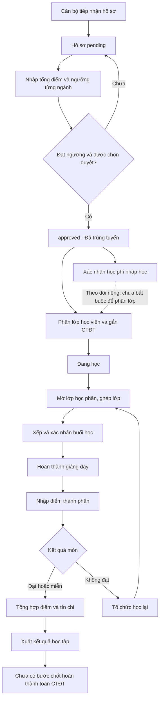

# Đánh giá logic vòng đời hồ sơ học viên

Ngày đánh giá: 15/10/2026. Đối tượng: mã nguồn hiện có trong workspace, bao gồm các thay đổi chưa commit.

**Cập nhật triển khai 18/10/2026:** đã xử lý F01–F08. Các mô tả hiện trạng, tình huống và đề xuất trong từng phát hiện bên dưới ghi nhận thời điểm rà soát ban đầu; đoạn **Đã xử lý** ghi nhận cách sửa hiện tại. Kế hoạch thực hiện và hướng dẫn triển khai được cập nhật ở mục 7; kết quả kiểm thử mới ở cuối mục 9.

## 1. Kết luận

Luồng thạc sĩ đã triển khai từ tiếp nhận hồ sơ, xét tuyển theo ngưỡng, xác nhận học phí, phân lớp, gắn CTĐT, mở lớp học phần, xếp lịch đến nhập điểm, gửi duyệt, khóa điểm và lưu bản kết quả học tập. Sau xử lý F01–F08, hệ thống kiểm tra hoàn thành học phần theo CTĐT áp dụng, chỉ tính điểm đã duyệt hoặc công nhận đã duyệt, đồng thời giữ lịch sử lớp và kết quả đã lưu. **Hoàn thành học phần không đồng nghĩa đủ điều kiện tốt nghiệp**; luận văn, bảo vệ, GPA và các điều kiện quản lý khác cần quy định riêng.

Luồng tiến sĩ chưa hoàn chỉnh: các nghiệp vụ trong `DoctoralService` trả `not_implemented`; scheduling hiện chỉ bật `masters`.

Phạm vi rà soát gồm cấu trúc repository, tài liệu nghiệp vụ, controller/guard, model/migration và các service/UI/test liên quan đến vòng đời học viên. Không có nghĩa là kiểm tra thủ công từng dòng tài nguyên, thư viện, mã sinh tự động hoặc mọi chức năng ngoài phạm vi này. Đây là đánh giá mã nguồn và kiểm thử sẵn có; chưa phải nghiệm thu một hồ sơ thật qua trình duyệt và PostgreSQL.

Lần đánh giá ban đầu chỉ đọc mã. Các lần sửa sau đó có thay đổi mã và chạy migration/kiểm thử trên PostgreSQL tạm riêng; không ghi vào database phục vụ công việc.

## 2. Các thực thể cần phân biệt

| Thực thể | Ý nghĩa và vai trò hiện tại |
|---|---|
| `students` | Tài khoản sinh viên theo hệ cũ, có mật khẩu, `accountType`, `approvalState` |
| `submissions` | Tệp sinh viên nộp theo số lần; không phải hồ sơ tuyển sinh mới |
| `admission_records` | Hồ sơ tuyển sinh và hồ sơ học viên trong luồng mới; có thể không liên kết `studentId` |
| `admission_rounds/evaluations/history` | Đợt xét tuyển, điểm, quyết định và lịch sử |
| `class_groups/members` | Lớp học viên; gắn ngành, khóa, CTĐT và thành viên |
| `curriculums/curriculum_subjects` | Chương trình và tập học phần áp dụng |
| `course_offerings` | Lớp học phần cụ thể; có thể ghép nhiều lớp học viên |
| `course_offering_class_groups/students` | Quyền tham gia lớp học phần theo lớp hoặc cá nhân |
| `teaching_sessions` | Buổi học; trạng thái planned/held/not_held |
| `course_exam_gradebooks` | Điểm học phần thực tế trong luồng mới, lưu các dòng điểm bằng JSONB |
| `learner_subject_results/subject_recognitions` | Kết quả học trước, kết quả học tập và công nhận học phần |
| `study_leaves/course_offering_withdrawals` | Bảo lưu, tiếp nhận học lại và bằng chứng rút khỏi lớp học phần |

**Hai định danh không tương đương:** một người có thể được nhận diện bằng `student:<uuid>` hoặc `admission:<uuid>`. Các phần mới đã có nhiều đoạn đối soát hai dạng này, nhưng vẫn cần quy tắc định danh và liên kết tài khoản thống nhất khi triển khai cổng học viên.

## 3. Luồng đang hoạt động

### 3.1. Tiếp nhận và nộp hồ sơ

- API tạo hồ sơ mới chỉ cho admin, yêu cầu tên và ngành hợp lệ; tự sinh email dạng `candidate_...` khi thiếu.
- Trạng thái mặc định là `pending`, `studyStatus = Nộp hồ sơ đầu vào`.
- Luồng này là cán bộ nhập hồ sơ. Không thấy API tự đăng ký/tự nộp hồ sơ tuyển sinh mới của ứng viên.
- `/user/submit` chỉ upsert tệp vào `submissions`; `/data/submitreview` trả lại body, chưa lưu quyết định duyệt. Hai chức năng này không tạo hay duyệt `AdmissionRecord`.

Nguồn: `backend/src/plan/plan.service.ts:654`, `backend/src/auth/user.controller.ts`, `backend/src/students/students.service.ts:67`, `backend/src/management/data.controller.ts`.

### 3.2. Xét tuyển

- Tạo đợt chung cho toàn viện, đặt điểm ngưỡng theo ngành và năm.
- Tổng điểm nhập tay 0–20 được so trực tiếp với ngưỡng ngành; bằng ngưỡng được tính đạt; thiếu điểm không được coi là 0.
- Duyệt hàng loạt kiểm tra lại preview, phiên bản, snapshot và điều kiện trong transaction. Quyết định cập nhật `status=approved`, `studyStatus=Đã trúng tuyển`, kèm lịch sử.
- Không áp dụng chỉ tiêu để loại hồ sơ đạt ngưỡng. Đây là hành vi được tài liệu hiện hành quy định, không phải lỗi thiếu giới hạn số lượng.
- Nhánh tổng điểm nhập tay không yêu cầu các cờ xác minh văn bằng, sức khỏe, giấy tờ hay bổ sung kiến thức. Cần hiểu đây là việc nhập kết quả đã được cán bộ chốt ở ngoài hệ thống; không thể dùng trạng thái approved để khẳng định từng minh chứng đã được hệ thống kiểm tra.

Nguồn: `docs/admission-evaluation.md`, `backend/src/plan/admission-scoring.ts:65`, `backend/src/plan/admission-evaluation.service.ts:159`.

### 3.3. Nhập học, học phí và phân lớp

- Học phí được lưu riêng tại `extraData.tuitionPayment`, kiểm tra `updatedAt` và ghi lịch sử.
- Phân lớp kiểm tra thạc sĩ, ngành, khóa, lớp đang mở, sĩ số và việc đã thuộc lớp khác; dùng transaction/khóa và ràng buộc chống trùng.
- Sau phân lớp, hồ sơ được cập nhật thành `Đang học`.
- Học phí hiện là thông tin theo dõi, không phải điều kiện chặn phân lớp. Cả UI và backend đều cho chọn học viên chưa đóng học phí.
- CTĐT được gắn theo ngành/bậc/khóa hoặc lựa chọn cụ thể; nếu có nhiều CTĐT phù hợp thì phải chọn.

Nguồn: `backend/src/masters/masters.service.ts:293`, `backend/src/plan/curriculum.service.ts:398`, `frontend/src/pages/masters/assignClassGroups.jsx`.

### 3.4. Học phần và giảng dạy

- Mở lớp học phần kiểm tra CTĐT của từng lớp, tương thích môn học, phạm vi học chung và lịch sử mở lớp.
- Học lại dùng danh sách riêng theo lớp gốc; không mở lại toàn bộ lớp đã hoàn thành một cách tùy ý.
- Xếp lịch có kiểm tra giảng viên, phòng, thời gian và xung đột.
- Hoàn thành giảng dạy yêu cầu ít nhất một buổi `held`; các buổi chưa xử lý phải được giải quyết hoặc xác nhận xóa với danh sách dự kiến khớp.
- Chỉ sau khi lớp học phần `completed` mới được lưu điểm.
- Chưa có ràng buộc đủ tổng số tiết/buổi bắt buộc để đóng lớp: một buổi held cũng có thể đáp ứng điều kiện hiện tại. Cần quy định số giờ chuẩn nếu muốn dùng trạng thái completed làm chứng cứ đã dạy đủ chương trình.

Nguồn: `backend/src/scheduling/scheduling.service.ts:1008`, `:1683`, `backend/src/masters/exam-gradebook.service.ts:277`.

### 3.5. Tư cách thi, nhập điểm và tổng hợp

- Tư cách thi thực tế trong bảng điểm được suy từ điểm kiểm tra và BTL/TL/KT theo ngưỡng cấu hình; chưa phải quy trình xét đầy đủ chuyên cần, học phí và quyết định tư cách thi.
- Trang/API `exam-eligibility` độc lập vẫn là stub. Không nên kết luận hoàn toàn chưa có kiểm tra tư cách, vì bảng điểm đã có logic này.
- Mặc định cũ: tỷ trọng 25%/25%/50%; điểm thành phần tối thiểu 4; điểm học phần tối thiểu 5,5. Cấu hình có thể thay đổi nên đây không phải bộ giá trị cố định cho mọi môn.
- Backend tự tính tổng điểm, điểm chữ, thang 4 và kết quả, không tin giá trị tổng hợp do client gửi.
- Thiếu điểm giữ pending; điểm 0 được phân biệt với thiếu điểm; không đủ tư cách có thể thành failed với điểm học phần 0 trước khi nhập điểm thi.
- Lưu điểm có revision chống ghi đè và snapshot cách tính; chưa có duyệt/khóa/phát hành bảng điểm.
- Công nhận tín chỉ có kiểm tra kết quả hoàn thành và đạt/miễn; tính tín chỉ có khử trùng theo môn gốc.
- Xuất bảng điểm đã có; GPA sau đại học hiện để trống có chủ ý vì chưa có công thức chính thức. Không lấy GPA đại học đầu vào làm GPA sau đại học.

Nguồn: `backend/src/masters/exam-grade-calculation.ts`, `backend/src/masters/exam-gradebook.service.ts:215`, `backend/src/plan/subject-recognition.service.ts:500`, `TRANSCRIPT-BUSINESS-QUESTIONS.md`.

## 4. Các lỗi và khoảng trống ưu tiên xử lý

Mức P1: ảnh hưởng quyền truy cập, tính đúng đắn điểm hoặc nền tảng dữ liệu học tập. Mức P2: ảnh hưởng trạng thái và khả năng chốt quy trình. Các tình huống dưới đây suy ra từ mã nguồn, trừ phần có ghi đã được test xác nhận.

### F01 — P1: tài khoản học viên có thể đọc hồ sơ của người khác qua API

**Đã xử lý sau rà soát:** thêm `RolesGuard` và vai trò cán bộ mặc định (`admin`, `supervisor`, `examiner`) cho `PlanController`, `StudyLeaveController` và `MastersController` (đường đọc danh sách lớp cũng chứa thông tin học viên). Vai trò ghi riêng từng endpoint vẫn có hiệu lực. Test HTTP dùng guard thật xác nhận chặn khách, student, vai trò lạ và đối tượng giả role; cho phép cán bộ đọc và giữ quyền tạo hồ sơ chỉ cho admin. Các API này phục vụ nghiệp vụ cán bộ; chưa bổ sung API tự phục vụ cho học viên.

`PlanController` chỉ dùng `AuthenticatedGuard` ở cấp controller. Các GET danh sách/chi tiết hồ sơ, kết quả học tập và công nhận tín chỉ không có RolesGuard hay kiểm tra chủ sở hữu. `StudyLeaveController` cũng chỉ yêu cầu đăng nhập cho GET.

Tình huống: một tài khoản student hợp lệ gọi `GET /plan/admission-records`, sau đó đọc chi tiết UUID lấy từ danh sách. Service không nhận current user để giới hạn phạm vi; chi tiết có CCCD, ngày sinh, liên hệ và thông tin văn bằng.

Đề xuất: GET nghiệp vụ cán bộ phải có vai trò phù hợp; API của học viên phải lọc theo chủ sở hữu phía server. Việc ẩn menu frontend không giải quyết quyền truy cập API.

Nguồn: `backend/src/plan/plan.controller.ts:19`, `:64`, `:84`, `backend/src/common/authenticated.guard.ts`, `backend/src/plan/study-leave.controller.ts:9`.

### F02 — P1: chọn kết quả học lại không nhất quán giữa báo cáo và scheduling

**Đã xử lý sau rà soát:** bổ sung `attempted_at` từ `course_offerings.created_at` vào nguồn kết quả chung, bao gồm kết quả gián đoạn do bảo lưu. Báo cáo, kết quả học tập, môn đã học, đồng bộ kết quả và SQL học lại dùng cùng quy tắc ưu tiên lần học theo thời điểm mở lớp, sau đó mới xét thời điểm sửa và ID bản ghi khi bằng thời điểm. Giữ cơ chế ưu tiên quyết định công nhận đã duyệt. Không cần migration hay sửa dữ liệu điểm hiện có.

Test PostgreSQL trên instance tạm riêng xác nhận lần học lại mới (đạt/không đạt/chưa có kết quả/miễn) vẫn được chọn khi bảng điểm cũ được sửa muộn hơn; sửa điểm người khác trong bảng cũ không đổi kết quả học viên; báo cáo, kết quả cá nhân, môn đã học, tín chỉ, đồng bộ và danh sách học lại thống nhất.

`examOutcomesSql()` dùng `book.updated_at` làm thời điểm kết quả. Bảng điểm tổng hợp và môn đã học chọn kết quả theo thời điểm này. Trong khi đó, `failedRetakeMembers()` ưu tiên thời điểm tạo lần học (`attemptedAt`) trước thời điểm sửa điểm.

Tình huống:

1. Lớp học phần A học trước, kết quả không đạt.
2. Lớp học lại B học sau, kết quả đạt.
3. Sau đó cán bộ sửa bảng điểm A — thậm chí chỉ sửa điểm của người khác trong cùng bảng JSONB.
4. `updated_at` của toàn bộ bảng A tăng. Báo cáo có thể chọn điểm không đạt cũ của học viên, nhưng danh sách cần học lại vẫn coi lần B đạt là kết quả mới nhất.

Đề xuất: quy định thứ tự lần học/lần thi và dùng một resolver chung cho báo cáo, tín chỉ và học lại; có thời điểm cập nhật riêng từng dòng. Không dùng thời điểm sửa bảng điểm của cả lớp để suy ra thứ tự lần học của một người.

Nguồn: `backend/src/plan/exam-outcomes.ts:29`, `backend/src/reports/class-score-summary.service.ts:214`, `backend/src/plan/subject-recognition.service.ts:140`, `backend/src/scheduling/retake-groups.ts`.

Test sẵn có xác nhận scheduling cố ý giữ lần đạt mới dù lần không đạt cũ được sửa sau: `backend/test/unit/retake-groups.spec.ts:26`. Chưa thấy test liên thông xác nhận báo cáo phải cho cùng kết quả trong tình huống này.

### F03 — P1: đổi ngành/khóa/CTĐT của lớp đã có dữ liệu không kiểm tra học viên hiện hữu

**Đã xử lý sau rà soát:** `ClassGroupService.update()` chỉ áp dụng khi phạm vi thực sự đổi (bậc, chuyên ngành, khóa, mã lớp suy ra khóa, CTĐT); nếu lớp đã có thành viên, lớp học phần, bảng điểm, bằng chứng rút khỏi lớp học phần hoặc lịch sử chuyển ngành thì trả `CLASS_SCOPE_IN_USE` và không ghi gì. Cùng ràng buộc được áp cho các đường tự gắn CTĐT (`assignToClassGroup`, `findForClassGroup`, kể cả đường đọc danh mục môn của lớp cũ), nên không còn âm thầm đổi CTĐT của lớp đã dùng. Đường ghi từ giao diện (`PUT /masters/class-groups/:id`) đi qua chính `ClassGroupService.update()`. Sửa ghi chú, sĩ số và các giá trị phạm vi không đổi vẫn được phép. Màn hình sửa lớp chưa tự khóa các trường phạm vi; người dùng nhận thông báo từ máy chủ.

`ClassGroupService.update()` cho cập nhật ngành, khóa và gắn CTĐT mới. Kiểm tra thành viên chỉ áp dụng khi giảm sĩ số; không chặn đổi phạm vi khi đã có học viên, lịch học hoặc điểm.

Tình huống: lớp CNTT đã có hồ sơ và điểm được chuyển sang QTKD bằng sửa lớp. Hồ sơ học viên vẫn ở ngành cũ nhưng lớp theo ngành/CTĐT mới. Báo cáo lấy môn từ CTĐT mới; môn đã học có thể biến mất khỏi tập cột.

Đề xuất: khóa ngành/khóa/CTĐT sau khi phát sinh thành viên hoặc dữ liệu đào tạo; thay đổi phải qua nghiệp vụ chuyển có kiểm tra tác động và lịch sử. Không dùng sửa lớp thay cho chuyển ngành học viên.

Nguồn: `backend/src/plan/class-group.service.ts:134`, `:164`, `:173`, `backend/src/plan/curriculum.service.ts:398`.

### F04 — P1: sửa CTĐT đang dùng có thể làm thay đổi bảng điểm lịch sử

**Đã xử lý sau rà soát:** chọn bất biến phạm vi thay cho version hóa CTĐT. `setSubjects()` và `update()` của `CurriculumService` trả `CURRICULUM_IN_USE` khi CTĐT đã được lớp chọn hoặc đã có trong lịch sử chuyển ngành; `remove()` cũng chặn theo cùng điều kiện. `replaceSubjects()` giờ chỉ còn chạy ở đường tạo CTĐT mới hoặc sau bước kiểm tra trên. Sửa học phần danh mục (`updateSubject()`) bị chặn bằng `SUBJECT_STRUCTURE_IN_USE` khi học phần — hoặc học phần gốc/tương đương cùng chuỗi — đã dùng trong CTĐT của lớp, lớp học phần, kết quả học tập, công nhận tín chỉ hay học bổ sung kiến thức; `removeSubject()` vốn đã chặn xóa học phần còn trong CTĐT. Tập môn của báo cáo lấy từ `curriculum_subjects` của CTĐT lớp, nên khóa sửa CTĐT là đủ để bảng điểm đã xuất không đổi tập môn và số tín chỉ. Giao diện tab 2 đã chặn thêm/loại học phần và làm sạch CTĐT khi CTĐT đã gắn lớp, kèm cảnh báo lý do. Chưa làm: đánh số phiên bản CTĐT theo quyết định và snapshot bảng điểm đã phát hành (nằm ở phạm vi F07/F08).

`setSubjects()/replaceSubjects()` cho bỏ học phần khỏi CTĐT, không kiểm tra lớp đang sử dụng hoặc điểm đã có. Báo cáo lấy tập môn trực tiếp từ CTĐT và thông tin tín chỉ hiện tại của danh mục môn.

Tình huống: bỏ môn đã có điểm khỏi CTĐT của khóa đang học rồi xuất lại bảng điểm; môn đó không còn nằm trong danh sách môn của báo cáo, dù bản ghi điểm có thể vẫn còn trong database. Thay đổi tín chỉ danh mục cũng ảnh hưởng số tín chỉ được hiển thị/tổng hợp.

Đề xuất: version CTĐT theo quyết định; khóa phiên bản áp dụng cho khóa/lớp; điều chỉnh phải có quy trình và ánh xạ tương đương. Bảng điểm đã phát hành cần snapshot môn, tín chỉ và kết quả.

Nguồn: `backend/src/plan/curriculum.service.ts:298`, `:605`, `backend/src/reports/class-score-summary.service.ts:149`.

*Cập nhật phần còn lại của F04: bản kết quả bất biến đã được bổ sung ở F08. Phương án CTĐT hiện tại là khóa cấu trúc đã dùng; version hóa/chuyển đổi hồi tố CTĐT vẫn là nghiệp vụ mở rộng riêng.*

### F05 — P2: xóa khỏi lớp làm trạng thái hiển thị và trạng thái nghiệp vụ khác nhau

**Đã xử lý 18/10/2026:** rút học viên được thực hiện trong transaction, khóa lớp/hồ sơ, lưu lịch sử membership trước khi xóa thành viên hiện tại, rồi cập nhật trạng thái lưu theo phân lớp thực tế. Không còn lớp cùng bậc thì trở về `Đã trúng tuyển`; còn lớp thì giữ `Đang học`. Chặn thao tác trực tiếp khi đang bảo lưu/thôi học. Migration 061 đối soát hai trạng thái này cho dữ liệu cũ, không ghi đè các trạng thái bảo lưu/thôi học/hoàn thành. Phân lớp, chuyển ngành và duyệt điểm dùng cùng khóa transaction để tránh thay đổi roster trong lúc chốt điểm.

`removeMember()` chỉ xóa membership. `AdmissionRecord.studyStatus` còn `Đang học`. API đọc hồ sơ lại dùng SQL suy diễn thành `Đã trúng tuyển` khi không có lớp.

Hệ quả: UI có thể hiển thị Đã trúng tuyển nhưng `AdmissionEvaluationService.decide()` vẫn chặn mở lại vì đọc trạng thái lưu là Đang học. Ngược lại, yêu cầu bảo lưu có thể qua điều kiện trạng thái lưu dù học viên không còn lớp.

Đề xuất: xóa/chuyển lớp và trạng thái trong cùng transaction; quyết định rõ nguồn trạng thái duy nhất. Các service xét tuyển, học phí, bảo lưu phải dùng cùng một chính sách xác định trạng thái.

Nguồn: `backend/src/masters/masters.service.ts:359`, `backend/src/plan/learner-study-status.ts`, `backend/src/plan/admission-evaluation.service.ts:198`, `backend/src/plan/study-leave.service.ts:181`.

### F06 — P2: bỏ thành viên lớp có thể làm mất khả năng tra cứu theo lớp cũ

**Đã xử lý 18/10/2026:** thêm `class_membership_history` và view `academic_class_members`. Rút lớp và duyệt chuyển ngành lưu thời gian vào/rời lớp, người thực hiện, lý do trong cùng transaction. Báo cáo và bảng điểm cá nhân đọc cả lớp hiện tại và lớp lịch sử; ưu tiên lớp hiện tại khi mở mặc định. Roster điểm không kéo học viên đã rời lớp vào lớp học phần mở sau ngày rời. Chặn xóa lớp/hồ sơ có lịch sử cần giữ. Migration chỉ khôi phục membership đã mất nếu bảng điểm cũ còn định danh học viên; không suy đoán từ họ tên. Dữ liệu đã mất cả membership lẫn bằng chứng điểm cần đối soát thủ công từ nguồn lưu trữ.

Danh sách bảng điểm và API bảng điểm cá nhân dựa vào membership hiện tại. Xóa membership không giữ lịch sử thành viên, cũng không bảo toàn đăng ký lớp học phần đã hoàn thành như nghiệp vụ chuyển ngành đang làm.

Hệ quả: điểm JSONB cũ chưa chắc bị xóa, nhưng học viên có thể biến mất khỏi roster lớp cũ và bảng điểm cá nhân không còn lớp để chọn. Nếu vào lớp mới, khả năng hiện lại điểm còn phụ thuộc CTĐT/môn tương đương.

Đề xuất: lưu thời gian hiệu lực của membership; thao tác rút/chuyển lớp phải giữ quyền đọc lịch sử học phần và điểm. Không xóa cứng thành viên đã phát sinh học tập như thành viên nhập nhầm chưa có dữ liệu.

Nguồn: `backend/src/masters/masters.service.ts:359`, `backend/src/reports/class-score-summary.service.ts:20`, `:91`, đối chiếu `backend/src/plan/major-transfer.service.ts:173`.

### F07 — P2: chưa có quy trình duyệt và khóa điểm chính thức

**Đã xử lý 18/10/2026:** bổ sung vòng `draft → submitted → approved`, mở lại về `draft` phải có lý do. Admin/examiner gửi duyệt; chỉ admin duyệt hoặc mở lại. Máy chủ kiểm tra toàn bộ roster của lớp học phần, không phụ thuộc trang/bộ lọc trên giao diện; thiếu kết quả thì không gửi duyệt. Kiểm tra version trạng thái, tổng revision, roster và chính sách so với bản gửi duyệt; thay đổi phải mở lại và gửi lại. Bảng đã gửi/duyệt khóa mọi đường lưu điểm. Mỗi lần lưu/chuyển trạng thái ghi actor, căn cứ và dữ liệu trước/sau trong `gradebook_events`. Khi duyệt, điểm và chính sách xét được đóng băng; đổi ngưỡng hoặc miễn ngoại ngữ ở hồ sơ không làm tính lại điểm đã duyệt. Mở lại làm mất hiệu lực chốt của dữ liệu đang sửa, vẫn giữ audit và bản kết quả đã lưu trước đó. UI có nút xử lý trạng thái và xem lịch sử.

Gradebook chỉ có revision, grades và timestamps; lưu điểm chưa nhận actor để ghi từng thay đổi. Admin/examiner có thể sửa lại khi lớp đã completed. Revision chống ghi đè đồng thời không phải lịch sử kiểm toán và không phải khóa nghiệp vụ.

Hệ quả: bản xuất hôm nay có thể khác hôm trước; chưa xác định ai sửa điểm nào, căn cứ nào, ai duyệt và bản nào đã phát hành.

Đề xuất: trạng thái nhập nháp → gửi duyệt → duyệt/khóa → mở sửa có lý do; audit trước/sau từng dòng, người thực hiện, lần học/lần thi; snapshot bản phát hành.

Nguồn: `backend/src/database/models/training/course-exam-gradebook.model.ts`, `backend/src/masters/exam-gradebook.service.ts:215`, `backend/src/masters/masters.controller.ts:41`.

### F08 — P2: chưa có bộ kiểm tra hoàn thành toàn bộ học phần

**Đã xử lý 18/10/2026:** `academicProgress()` trả kết luận và các điều kiện thiếu: học phần bắt buộc, học phần tự chọn chưa gắn nhóm, tín chỉ tối thiểu theo nhóm/khối, điểm chưa duyệt và cấu hình nhóm không hợp lệ. Tín chỉ chỉ tính kết quả đạt/miễn đã chốt hoặc công nhận đã duyệt, khử trùng theo học phần gốc; cùng học phần gốc nằm ở nhiều nhóm yêu cầu bị chặn để đối soát. `maxCredits = 0` giữ nghĩa không giới hạn như cấu hình hiện tại. Bảng điểm cá nhân hiển thị tiến độ và điều kiện thiếu. Admin chỉ lưu được bản kết quả khi hoàn thành học phần; snapshot chứa danh sách môn, tín chỉ, điểm, chính sách, thời điểm và người lưu, kèm SHA-256 kiểm tra toàn vẹn. Có thể mở lại bản cũ sau khi dữ liệu hiện hành thay đổi; giữ nguyên ngày của bản đã lưu. Không tự sinh GPA, số văn bằng, chữ ký hay quyết định tốt nghiệp.

Có điểm từng môn, số tín chỉ đã đạt/công nhận và bảng điểm, nhưng chưa có kết luận chính thức hoàn thành CTĐT với danh sách điều kiện thiếu: môn bắt buộc, tín chỉ tự chọn theo nhóm, môn tương đương, điểm chưa chốt, học lại chưa hoàn thành, ngoại ngữ và phần luận văn nếu thuộc phạm vi.

`graduationDocs/finalDefense` của thạc sĩ còn stub. Xuất được PDF/DOCX không chứng minh học viên đã hoàn thành các môn; bằng nhau về tổng tín chỉ cũng chưa đủ nếu thiếu một môn bắt buộc.

Đề xuất: một service đánh giá tiến độ theo đúng phiên bản CTĐT, trả điều kiện đã đạt/chưa đạt và chứng cứ; tách hoàn thành môn học với đủ điều kiện tốt nghiệp.

Nguồn: `backend/src/plan/subject-recognition.service.ts:500`, `backend/src/masters/masters.service.ts:41`, `frontend/src/features/learners/learnerTranscript.js:37`.

## 5. Các chính sách nghiệp vụ cần quyết định riêng

Đây là hành vi hiện tại hoặc khoảng trống nghiệp vụ, không tự động coi tất cả là lỗi lập trình:

| Vấn đề | Hành vi hiện tại | Quyết định cần chốt |
|---|---|---|
| Học phí nhập học | Theo dõi riêng, không chặn phân lớp | Có bắt buộc đóng trước khi vào lớp? Cho nợ/miễn theo quyết định nào? |
| Xác minh đầu vào | Nhập tổng điểm có thể bỏ qua cờ xác minh | Kết quả ngoài hệ thống là đủ hay cần checklist bắt buộc trước duyệt? |
| Tư cách thi | Chủ yếu suy từ hai điểm quá trình | Có thêm chuyên cần, học phí, kỷ luật, quyết định hội đồng? |
| Hoàn thành giảng dạy | Chỉ cần ít nhất một buổi held và xử lý planned | Có cần đủ giờ chuẩn/tín chỉ và quyết định đóng sớm? |
| Thay đổi ngưỡng điểm | Điểm nháp dùng ngưỡng hiện hành; điểm đã duyệt giữ chính sách lúc duyệt | Việc hồi tố điểm đã duyệt phải qua mở lại có căn cứ và duyệt lại |
| Miễn ngoại ngữ | Tick hồ sơ suy ra passed, không cần điểm | Đây là miễn thi tuyển sinh hay miễn học phần trong CTĐT? Có cần minh chứng, thời hạn, người duyệt? |
| Điểm học lại | Scheduling ưu tiên lần học mới; báo cáo ưu tiên lần sửa mới | Chọn lần học cuối, điểm cao nhất hay quyết định riêng? |
| Hệ thống học viên | Hồ sơ mới không tự tạo/liên kết tài khoản | Có yêu cầu học viên đăng nhập theo dõi hồ sơ/điểm của mình? |
| GPA | Chưa cung cấp, để trống có chủ ý | Thang, trọng số tín chỉ, môn miễn/công nhận, lần học, làm tròn |

Lưu ý: test áp dụng ngưỡng tư cách mới lên điểm cũ tiếp tục có hiệu lực với **điểm nháp**. F07 bổ sung ranh giới rõ ràng: điểm đã duyệt được đóng băng, chỉ thay đổi sau mở lại có lý do và duyệt lại.

**Đã xử lý chuẩn hóa đầu vào:** DTO tạo/sửa hồ sơ chuẩn hóa các tên bậc tiếng Anh/không dấu về hai giá trị đang dùng trong hệ thống (`Thạc sĩ`, `Tiến sĩ`), giới hạn tập `studyStatus`, validate enum `status`. Migration chuẩn hóa các alias cũ đã biết. Chưa chuyển toàn bộ schema sang hệ mã mới; dữ liệu lạ khác cần đối soát, không tự suy diễn.

## 6. Bảo lưu, công nhận tín chỉ và chuyển ngành

Những phần đã có kiểm soát tốt:

- Bảo lưu có yêu cầu, duyệt/từ chối, gia hạn, tiếp nhận học lại/thôi học, lịch sử và kiểm tra ngày theo múi giờ Việt Nam.
- Có snapshot rút khỏi lớp học phần, phân biệt môn chưa bắt đầu và môn đã có lịch/điểm. Kết quả không đạt do bảo lưu được suy từ bằng chứng, không tự bịa điểm thi.
- Chuyển ngành ghi yêu cầu trước, không đổi ngành ngay khi mới đề nghị. Khi duyệt có đối chiếu CTĐT đích, công nhận môn và giữ đăng ký các lớp học phần đã hoàn thành.
- Công nhận môn kiểm tra bằng chứng học trước; trường hợp tương đương cần xem xét không được suy từ số tín chỉ đơn thuần; tín chỉ được tính khử trùng.

Các test PostgreSQL cho bảo lưu, scheduling, học lại và bảng điểm đã được chạy trên database test riêng trong lần xử lý F05–F08; xem số liệu ở cuối mục 9.

## 7. Kế hoạch thực hiện — cập nhật 18/10/2026

- [x] F01: giới hạn quyền API hồ sơ, điểm và bảo lưu cho cán bộ.
- [x] F02: thống nhất thứ tự lần học/kết quả giữa học lại, báo cáo, công nhận và tín chỉ.
- [x] F03/F04: khóa phạm vi lớp và cấu trúc CTĐT/học phần đã dùng. Áp dụng phương án bất biến và tạo CTĐT khác cho khóa mới; chưa xây quy trình version hóa/chuyển đổi hồi tố một lớp đang học.
- [x] F05: đồng nhất trạng thái lưu với phân lớp; rút lớp và cập nhật trạng thái cùng transaction; đối soát dữ liệu cũ bằng migration.
- [x] F06: giữ lịch sử membership, tra cứu bảng điểm lớp cũ, bảo vệ lịch sử khi xóa.
- [x] F07: gửi duyệt, duyệt/khóa, mở lại có lý do; audit và đóng băng chính sách điểm đã duyệt.
- [x] F08: kiểm tra hoàn thành học phần, hiển thị điều kiện thiếu, lưu/mở bản kết quả bất biến và kiểm tra toàn vẹn.
- [x] Chuẩn hóa và validate bậc/trạng thái hồ sơ tại API.
- [x] Kiểm thử đơn vị, HTTP, PostgreSQL riêng, migration từ database trống và build.

**Triển khai:** sao lưu database, sau đó chạy `npm --prefix backend run db:migrate` từ thư mục gốc và khởi động lại backend/frontend. Migration `061-academic-lifecycle` tạo lịch sử lớp, trạng thái duyệt điểm, audit và bản kết quả; điểm cũ mặc định là nháp, không tự coi là đã được duyệt. Migration không hỗ trợ tự động `down` vì không được xóa lịch sử học tập; rollback cần bản sao lưu đã kiểm chứng. Chưa chạy migration trên database công việc trong lần sửa này.

**Nghiệm thu vận hành:** hoàn thành giảng dạy → lưu đủ điểm → gửi duyệt toàn lớp học phần → admin duyệt/khóa → mở bảng điểm cá nhân kiểm tra điều kiện thiếu → lưu bản kết quả đã chốt. Khi điều chỉnh: admin mở lại với lý do → sửa/lưu → gửi/duyệt lại; bản kết quả cũ vẫn tra cứu riêng.

**Ngoài phạm vi F01–F08:** các quyết định ở mục 5, cổng học viên tự phục vụ, quy trình luận văn/bảo vệ và nghiệp vụ tiến sĩ chưa triển khai. Không tự đặt chính sách học phí, chuyên cần, GPA hoặc điều kiện tốt nghiệp. Tài liệu `NGHIEP-VU-KE-HOACH-DAO-TAO.md` là phân tích gói học phần cũ; trạng thái triển khai hiện hành theo mục này.

## 8. Các kịch bản nghiệm thu bắt buộc

| Kịch bản | Kết quả cần kiểm chứng |
|---|---|
| Hồ sơ đúng ngưỡng, chưa đóng học phí | Duyệt đúng; phân lớp theo chính sách đã chốt |
| Hồ sơ thiếu điểm hoặc ngành chưa có ngưỡng | Không duyệt nhầm; điểm 0 không bị coi là thiếu |
| Hai cán bộ cùng duyệt/lưu điểm | Một thao tác cũ bị chặn; không mất cập nhật |
| Một học viên được phân đồng thời vào hai lớp | Chỉ một membership hợp lệ |
| Bỏ lớp rồi mở lại xét tuyển | UI và API thống nhất trạng thái, không mắc kẹt |
| Sửa ngành/khóa/CTĐT của lớp đã có điểm | Bị chặn hoặc đi qua quy trình điều chỉnh có lịch sử |
| Xóa môn đã có điểm khỏi CTĐT | Không làm mất môn trên bảng điểm đã phát hành |
| Học lại đạt rồi sửa bảng điểm lớp cũ | Báo cáo, tín chỉ và danh sách học lại cùng chọn kết quả đúng |
| Sửa điểm một người trong bảng lớp cũ | Không thay đổi thứ tự lần học của người khác |
| Bảo lưu trước/sau thời điểm môn bắt đầu, sau đó học lại | Giữ lịch sử, không cấp nhầm tín chỉ và không mất hàng đợi |
| Chuyển ngành với môn đạt/không đạt/miễn | Chỉ công nhận đúng, không đếm tín chỉ hai lần |
| Tất cả môn có điểm nhưng thiếu một môn bắt buộc | Không đánh dấu hoàn thành CTĐT |
| Tổng tín chỉ đủ nhưng sai nhóm tự chọn | Không đánh dấu hoàn thành CTĐT |
| Student gọi API hồ sơ/điểm/bảo lưu của người khác | Bị từ chối hoặc chỉ trả dữ liệu của chính mình |

## 9. Kết quả kiểm thử trong lần đánh giá

Các số liệu bên dưới giữ lịch sử các lần kiểm tra. Kết quả mới nhất cho F05–F08 nằm ở tiểu mục cuối.

- Backend: `npm run test:unit -- --silent` — **37 suite đạt; 538/538 test đạt**.
- Frontend: `npm run test:ci -- --reporter=dot` — **39 tệp đạt, 20 tệp lỗi trong 59 tệp; 419 test đạt, 9 test thất bại trong 428 test được báo cáo; exit code 1**. Vitest còn báo một lỗi worker `Timeout calling "onTaskUpdate"`. Log có cảnh báo React `act(...)` và jsdom không parse được một số CSS in. Chưa phân loại nguyên nhân từng tệp lỗi; không suy diễn rằng cả 20 tệp đều lỗi logic nghiệp vụ, cũng không coi toàn bộ frontend đã được kiểm chứng. Số test thống kê không bao gồm đầy đủ các trường hợp trong những suite không chạy được.
- Chưa chạy migration, seed, PostgreSQL integration hay hành trình E2E với hồ sơ thật.
- Unit test đạt xác nhận các trường hợp đang được mô phỏng; không phủ định các vấn đề liên thông và khoảng trống nghiệp vụ nêu trên.

### Kiểm chứng sau khi sửa F01/F02

- Backend unit: **538/538 đạt**, 37 suite.
- Backend HTTP E2E: **35/35 đạt**, 2 suite; gồm test phân quyền mới.
- PostgreSQL: **16/16 đạt**, 2 suite (`exam-attempt-order-postgres` và `class-score-summary-postgres`) trên container PostgreSQL 16 tạm riêng. Chỉ tạo bảng tạm và rollback; không dùng database công việc. Container được dọn sau kiểm thử.
- `npm run typecheck`: đạt.
- Không chạy lại frontend vì thay đổi nằm ở phân quyền và truy vấn backend; kết quả frontend ở lần đánh giá trước được giữ nguyên để tham khảo.

### Kiểm chứng sau khi sửa F03/F04

- Backend unit: **557/557 đạt**, 37 suite (lần F01/F02: 538/538); gồm test mới cho phạm vi lớp, CTĐT và học phần danh mục.
- Backend HTTP E2E: **35/35 đạt**, 2 suite.
- PostgreSQL: **33 test đạt trong 4 suite chạy được** (`exam-attempt-order-postgres`, `class-score-summary-postgres`, `training-structure-postgres`, `health.controller`); 26 test bị skip ở 3 suite cần biến `RUN_POSTGRES_SCHEDULING_TESTS` và schema đầy đủ. Suite mới `training-structure-postgres.spec.ts` dùng bảng tạm trong transaction rồi rollback, xác nhận: cho phép khi chưa dùng; chặn theo từng bảng thành viên/lớp học phần/bảng điểm/bằng chứng rút; giữ phạm vi sau khi chuyển ngành đã xóa membership; khóa CTĐT ngay khi lớp rỗng chọn CTĐT; khóa cả học phần alias và học phần gốc; và khóa tuần tự giữa hai kết nối. Không dùng database công việc.
- `npm run typecheck`: đạt.
- Frontend: `npm run test:ci -- --reporter=dot` — **39 tệp đạt, 20 tệp lỗi trong 59 tệp; 419 test đạt, 9 test thất bại trong 428 test; exit code 1**, không đổi so với lần đánh giá trước (vẫn còn lỗi worker `Timeout calling "onTaskUpdate"`). Một tệp liên quan chức năng CTĐT (`TrainingPlanSubjectIdentity.test.jsx`, không nằm trong các tệp đã sửa) lỗi ngay khi nạp module do mock axios ESM. Các tệp đã sửa cho F03/F04 ở frontend nằm trong `trainingPlan.jsx`; test logic tab 2 (`trainingPlan.logic.test.js`) đạt 11/11.

### Kiểm chứng sau khi sửa F05–F08 (18/10/2026)

- Backend unit: **580/580 đạt**, 40 suite.
- Backend HTTP E2E: **49/49 đạt**, 2 suite; gồm chặn student đọc lịch sử điểm/bản kết quả, giới hạn người lưu bản kết quả là admin và chặn supervisor thao tác quy trình điểm.
- PostgreSQL: **69/69 đạt**, 7 suite, bật đầy đủ test bảo lưu, scheduling, học lại và báo cáo trên PostgreSQL 16 tạm riêng. Sau bổ sung chặn xóa hồ sơ hiện tại/lịch sử, chạy lại suite học lại và vòng đời: **10/10 đạt**. Các fixture được rollback; không dùng database công việc.
- Migration: chạy toàn bộ **65 migration** (đến `061-academic-lifecycle`, tính cả các migration cùng số có hậu tố) trên database trống riêng thành công. Không seed hoặc thay đổi database công việc.
- Frontend liên quan: **125/125 đạt**, 10 tệp (`ExamLists`, `LearnerScorecard`, các test xuất bảng điểm và bản kết quả). Bổ sung kiểm tra khóa điểm đã duyệt, lý do mở lại, quyền gửi/duyệt và thông báo điều kiện còn thiếu. Sửa tương thích mock axios ESM để các suite cũ nạp được; cách ly fixture điểm và sự kiện Toastify giữa các test.
- Backend typecheck/build và frontend production build: đạt. Chưa nghiệm thu thao tác thủ công toàn hành trình bằng trình duyệt với hồ sơ thật.
