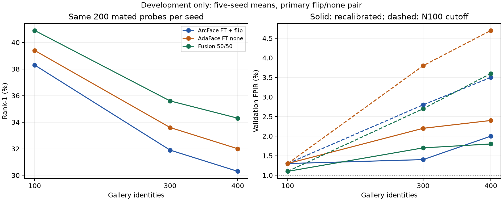

# ArcFace–AdaFace: bổ sung lỗi, fusion và gallery giữ nguyên probe — 29/10/2026

Fusion điểm 50/50 có tín hiệu cải thiện **ranking development**, nhưng chưa có
bằng chứng rõ về giảm FNIR tại ngưỡng calibration đang xét. Không triển khai
fusion vào điểm danh từ kết quả này. Thêm danh tính gây nhiễu làm rank-1 giảm
và FPIR tăng khi giữ nguyên cutoff; việc hiệu chỉnh cutoff theo N cũng không
bảo đảm validation FPIR bằng target.

## Thiết kế đã chốt trước kết quả

[Protocol](complementarity_nested_protocol_20261029.md) đã ghi trước khi tính
fusion/nested. Chỉ đọc 4 cache embedding development fine-tuned đã audit:
ArcFace none/flip và AdaFace best epoch 11 none/flip, cùng 2.000 ảnh.
Một ảnh nguồn/gallery ID; flip không thêm ảnh nguồn. Không inference ảnh,
train, dùng cloud hoặc mở tập test. Không trộn embedding giữa hai model.

Cặp chính: ArcFace FT+flip và AdaFace FT none; cặp phụ none/none, flip/flip.
Fusion = 0,5 × cosine ArcFace + 0,5 × cosine AdaFace; không dò trọng số,
fit scale hoặc chọn lại cấu hình tốt nhất. N=300 là so sánh chính, 5 seed
2026–2030. Giữ toàn bộ cấu hình/kích thước trong CSV, kể cả kết quả bất lợi.

Hai họ thí nghiệm riêng:

- **Frozen:** tái lập các episode cũ. N100/300/400 có 200/600/800 mated và
  500/300/200 validation unknown probes mỗi seed. Probe thay đổi theo N;
  không dùng họ này để kết luận tác động riêng của số distractor.
- **Nested:** mỗi seed có cố định 100 core identities với 200 mated probes,
  200 unknown calibration và 200 unknown validation probes (100 ID mỗi nhóm).
  Gallery tăng 100 → 300 → 400, giữ cùng ảnh gallery cho các ID chung;
  chỉ thêm distractor. Tính score một lần ở N400 rồi chọn cột cho từng N.
  Unknown không thể xuất hiện trong gallery lớn nhất. Ties theo ID lexical.

Cả hai vẫn là custom QMUL protocol, có trộn source-role gallery/mated trong
cùng ID. Không phải official benchmark hoặc physical-camera/session holdout.
Nested dùng pool/probe khác frozen; không so trực tiếp hai mức rank-1 như
thể chúng là cùng bộ mẫu.

## Đối chứng frozen: cặp chính

Mean ± sample SD qua 5 seed. FNIR/FPIR là validation, đơn vị %.
Ngưỡng được chọn riêng cho từng method/N/seed trên unknown calibration với
target FPIR 1% strict; attained validation FPIR khác nhau.

| N | Method | Rank-1 ± SD (điểm %) | FNIR | FPIR |
|---:|---|---:|---:|---:|
| 100 | ArcFace FT + flip | 36.50 ± 2.67 | 82.80 | 1.32 |
| 100 | AdaFace FT none | 35.70 ± 2.80 | 85.00 | 0.80 |
| 100 | Fusion 50/50 | 37.70 ± 4.13 | 83.00 | 1.04 |
| 300 | ArcFace FT + flip | 31.93 ± 1.18 | 87.03 | 1.13 |
| 300 | AdaFace FT none | 31.77 ± 1.47 | 88.80 | 0.87 |
| 300 | Fusion 50/50 | 33.83 ± 1.01 | 86.50 | 1.27 |
| 400 | ArcFace FT + flip | 30.52 ± 1.33 | 87.50 | 0.60 |
| 400 | AdaFace FT none | 30.43 ± 0.76 | 90.67 | 0.10 |
| 400 | Fusion 50/50 | 32.52 ± 0.67 | 87.20 | 0.60 |

Ở N300, fusion − ArcFace: rank-1 **+1,90 điểm %**, 95% paired identity-cluster
CI **[+0,82; +2,92]**; FNIR **−0,53 điểm %**, CI **[−1,36; +0,20]**.
Fusion có 19/1.500 lượt unknown bị nhận nhầm, ArcFace 17/1.500, AdaFace
13/1.500. Đây là lượt xuất hiện lặp qua seed, không phải 1.500 ảnh độc lập.
Không diễn giải FNIR thấp hơn như lợi ích ở cùng attained FPIR.

## Hai model có bổ sung lỗi không?

Ở frozen N300, chia tất cả mated appearances:

| Trường hợp | Tỷ lệ |
|---|---:|
| Cả hai đúng | 26,97% |
| Chỉ ArcFace đúng | 4,97% |
| Chỉ AdaFace đúng | 4,80% |
| Cả hai sai | 63,27% |
| Cả hai sai cùng một ID | 16,20% |
| Cả hai sai hai ID khác nhau | 47,07% |

Hai dòng cuối là phân rã của “cả hai sai”. AdaFace sửa được một phần lỗi
ArcFace; hai model vẫn cùng sai ở phần lớn probe. Fusion cứu 4,03% probe
ArcFace sai và làm hỏng 2,13% probe ArcFace đúng, ròng +1,90 điểm %.
Trong số probe cả hai sai, fusion vẫn cứu được 0,70% tổng probe.

Oracle chọn đúng giữa **hai top-1 outputs** có rank-1 36,73%. Đây là mức trần
của bộ chọn giả định biết nhãn, không phải giới hạn cho fusion score:
fusion có thể đưa true ID hạng 2 ở cả hai model lên hạng 1. Test tổng hợp
đã kiểm tra tình huống này. Không đề xuất oracle như thuật toán triển khai.

## Nested: cùng probe, tăng distractor

Vẫn chọn cutoff riêng theo N, cùng calibration identities/images trong seed:

| N | Method | Rank-1 ± SD (điểm %) | FNIR | FPIR |
|---:|---|---:|---:|---:|
| 100 | ArcFace FT + flip | 38.30 ± 3.93 | 81.70 | 1.30 |
| 100 | AdaFace FT none | 39.40 ± 4.14 | 82.30 | 1.30 |
| 100 | Fusion 50/50 | 40.90 ± 4.16 | 79.50 | 1.10 |
| 300 | ArcFace FT + flip | 31.90 ± 4.01 | 84.70 | 1.40 |
| 300 | AdaFace FT none | 33.60 ± 4.75 | 85.20 | 2.20 |
| 300 | Fusion 50/50 | 35.60 ± 4.57 | 83.80 | 1.70 |
| 400 | ArcFace FT + flip | 30.30 ± 3.91 | 84.90 | 2.00 |
| 400 | AdaFace FT none | 32.00 ± 3.54 | 85.20 | 2.40 |
| 400 | Fusion 50/50 | 34.30 ± 4.32 | 84.20 | 1.80 |

Nested N300: fusion − ArcFace rank-1 **+3,70 điểm %**, CI **[+2,03; +5,53]**;
FNIR **−0,90 điểm %**, CI **[−2,12; +0,38]**. Unknown false IDs: fusion
17/1.000 lượt, ArcFace 14/1.000, AdaFace 22/1.000.
FNIR fusion 83,80% = sai ranking 64,40% + đúng ranking nhưng bị reject 19,40%.
Phần sai ranking vẫn lớn; fusion chưa giải quyết được phần lớn lỗi native LR.

Ở chính fusion, N100 → N300 làm rank-1 giảm 5,30 điểm % (CI [−6,84;−4,00]);
N100 → N400 giảm 6,60 điểm % (CI [−8,25;−5,10]). Với recalibration, FNIR
tăng lần lượt 4,30 / 4,70 điểm %. Đây là tác động của **thêm distractor trong
episode development cố định**, không suy rộng thành mọi quần thể gallery.

### Chuyển nguyên cutoff từ N100

| Method | FPIR N100 | FPIR N300 | FPIR N400 |
|---|---:|---:|---:|
| ArcFace FT + flip | 1.30% | 2.80% | 3.50% |
| AdaFace FT none | 1.30% | 3.80% | 4.70% |
| Fusion 50/50 | 1.10% | 2.70% | 3.60% |

Fusion có 11 → 27 → 36 false identifications /1.000 validation appearances.
Recalibration giảm FPIR N400 từ 3,60% xuống 1,80%, đổi lại FNIR tăng từ
79,60% lên 84,20%. Attained FPIR vẫn không bằng target 1%.
Không dùng ngưỡng N100 nguyên trạng khi thay quy mô/danh sách người được quét.

## Cặp phụ và toàn bộ kết quả

Không chọn lại cặp chính sau khi xem kết quả. Bảng sau là fusion rank-1,
đơn vị %, với cutoff riêng theo N (rank-1 không phụ thuộc cutoff).

| Họ | Cặp Arc/Ada | N100 | N300 | N400 |
|---|---|---:|---:|---:|
| frozen | flip_none | 37.70 | 33.83 | 32.52 |
| frozen | none_none | 37.60 | 33.50 | 32.05 |
| frozen | flip_flip | 38.50 | 33.60 | 33.02 |
| nested | flip_none | 40.90 | 35.60 | 34.30 |
| nested | none_none | 40.70 | 35.20 | 33.40 |
| nested | flip_flip | 41.20 | 35.60 | 34.00 |

Tất cả singles, FNIR/FPIR, SD và CIs theo cặp phụ nằm trong các CSV tổng hợp.
Mức 40,90% ở nested N100 không thay cho gate N300 của đối chứng cũ.

## Kiểm chứng và giới hạn

- 4 cache kiểm tra SHA/order/identity/unit vector và tái tính metric cũ.
  90 score-evaluator comparisons tái lập baseline với tolerance 1e-12.
- 360 kiểm tra monotonic từng probe/seed/method: correctness không tăng,
  unknown max score không giảm, cutoff recalibration không giảm, false
  acceptance ở fixed cutoff không giảm khi thêm distractor.
- 405 policy rows, 81 summary rows, 90 complementarity rows, 27 paired
  fusion rows, 36 paired growth rows; 126.000 private mated probe rows.
  Source/protocol/cache/output SHA đã lưu; audit PASS.
- 18 targeted tests pass; full pytest kết quả được ghi trong kế hoạch.
- 1.000 paired identity-cluster bootstrap replicates. Giữ cố định gallery,
  episode và cutoff đã fit; không lượng hóa bất định calibration sampling,
  physical camera/session hoặc toàn bộ gallery population. Không hiệu chỉnh
  multiple comparisons; development đã dùng chọn checkpoint/phương án.
- Wilson CI mỗi seed chỉ là binomial reference có điều kiện. Mỗi unknown ID
  có 2 ảnh, seed lặp lại ID; không coi độc lập hoàn toàn. Với 0/200 events,
  Wilson upper vẫn khoảng 1,88%, không phải rủi ro bằng 0. Với 200 calibration
  probes và strict nextafter, achieved calibration có thể chỉ 0,5% hoặc thấp
  hơn; không sửa convention của kết quả frozen.
- Không đo serving latency của ensemble. Nó cần cả hai backbone và flip
  ArcFace, nên chưa đủ bằng chứng dùng trong camera realtime.

## Quyết định tiếp theo

Giữ ArcFace FT+flip làm baseline đơn model; giữ fusion 50/50 như ứng viên
nghiên cứu có tín hiệu ranking, chưa gọi là giải pháp điểm danh tốt hơn.
Chưa có lý do từ kết quả này để train thêm 15 epoch hoặc mở sweep trọng số.

Ưu tiên kế tiếp: tách một development protocol giữ đúng source-role, sau đó
đánh giá dữ liệu camera ứng dụng có known/unknown tách danh tính và đo latency
end-to-end. Chỉ chọn cutoff từ calibration, ghi FPIR/FNIR thực tế theo roster;
nếu thử distillation, cần đối chứng với fusion này và kiểm tra teacher trên
miền ảnh tương ứng. Tập test tiếp tục đóng; model production không thay đổi.

## Tái lập và artifacts

```powershell
.\.venv\Scripts\python.exe scripts/analyze_complementarity_nested.py --out outputs/complementarity_nested_dev_reproduction
.\.venv\Scripts\python.exe scripts/report_complementarity_nested.py
```

Runner thứ nhất tạo thư mục mới và từ chối ghi đè. Report renderer dùng run
đã audit `outputs/complementarity_nested_dev_20261029/` cố định, không đọc test.
Thư mục đó chứa protocol/audit, per_episode, summary, complementarity,
complementarity_summary, paired_fusion, paired_gallery_growth và probe_private.
Private IDs/paths ở outputs bị git-ignore; bản CSV trong workspace ứng dụng
chỉ chứa aggregate. Figure dùng chính aggregate, không có dữ liệu cá nhân:



Bản vector xuất được: [SVG](complementarity_nested_20261029.svg).
