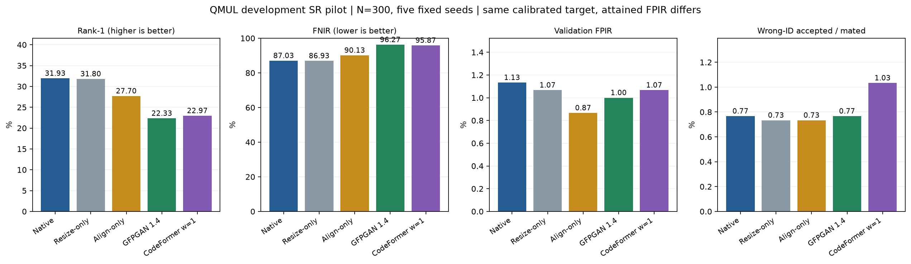

# Kết quả pilot SR trên development — 29/10/2026

**Đây là thăm dò development, không phải kết quả test hoặc xác nhận cho production.**

[Protocol đã ghi trước kết quả](sr_pilot_protocol_20261029.md).
Không training, không truy cập test v1/v2; cùng 2.000 ảnh, ArcFace FT+flip, N=300, seeds 2026–2030.

Alignment thành công **491/2000 (24.55%)**; **1509 ảnh** dùng baseline trong các nhánh alignment/SR. Không loại ảnh thất bại.
Cạnh ngắn native (min/Q1/median/Q3/max): [5.0, 15.0, 19.0, 24.0, 38.0] px.
Sai khác embedding baseline lớn nhất với cache đóng băng: **0**.

## Bảng chính

Mean tỷ lệ qua năm episode. Ngưỡng chọn riêng trên unknown calibration, target FPIR 1%; FPIR validation thực tế khác nhau, vì vậy bảng không phải so sánh matched-risk.

| Nhánh | Rank-1 % | FNIR % | FPIR % | Wrong-ID accepted / mated % |
|---|---:|---:|---:|---:|
| Native | 31.93 | 87.03 | 1.13 | 0.77 |
| Resize-only | 31.80 | 86.93 | 1.07 | 0.73 |
| Align-only | 27.70 | 90.13 | 0.87 | 0.73 |
| GFPGAN 1.4 | 22.33 | 96.27 | 1.00 | 0.77 |
| CodeFormer w=1 | 22.97 | 95.87 | 1.07 | 1.03 |

## Chênh lệch ghép cặp

Delta = nhánh SR − đối chứng, đơn vị điểm phần trăm. FNIR âm tốt hơn. CI bootstrap 2.000 lần theo identity trên pooled mated appearances, giữ phụ thuộc qua seed. Có điều kiện trên gallery/ngưỡng/model cố định, chưa tính bất định calibration và nhiều so sánh.

| Nhánh | Đối chứng | Δ Rank-1 [CI 95%] | Δ FNIR [CI 95%] |
|---|---|---:|---:|
| gfpgan14 | native | -9.60 [-11.44; -7.86] | +9.23 [+7.68; +10.96] |
| gfpgan14 | aligned | -5.37 [-6.66; -4.11] | +6.13 [+4.96; +7.45] |
| codeformer_w1 | native | -8.97 [-10.76; -7.28] | +8.83 [+7.26; +10.58] |
| codeformer_w1 | aligned | -4.73 [-5.89; -3.67] | +5.73 [+4.54; +7.09] |

## Tài nguyên và tốc độ

GPU: **NVIDIA GeForce RTX 3060 Laptop GPU**. Detector CPU ['CPUExecutionProvider'], alignment p50/p95: 24.6/34.8 ms.
Restoration batch1 FP32, model chạy tuần tự; số đo chỉ trên ảnh alignment thành công, bao gồm chuyển tensor/đọc output về CPU và warp về 112, không bao gồm embedding nhận diện hoặc model loading. Không loại lượt đầu khỏi số đo. CUDA reserved là bộ nhớ do allocator giữ, không phải toàn bộ VRAM tiến trình.

| Model | Số lượt restore | Lỗi | p50 ms | p95 ms | CUDA allocated MiB | CUDA reserved MiB |
|---|---:|---:|---:|---:|---:|---:|
| gfpgan14 | 491 | 0 | 172.6 | 189.5 | 1596 | 2150 |
| codeformer_w1 | 491 | 0 | 143.5 | 149.8 | 831 | 1128 |

## Gate và diễn giải

- **gfpgan14: không vượt gate pilot**. Điều kiện chưa đạt: fnir_delta_at_most_minus_3pp, fnir_delta_ci_upper_below_zero, benefit_vs_alignment_ci_upper_below_zero.
- **codeformer_w1: không vượt gate pilot**. Điều kiện chưa đạt: fnir_delta_at_most_minus_3pp, fnir_delta_ci_upper_below_zero, benefit_vs_alignment_ci_upper_below_zero.

Gate: FNIR giảm ít nhất 3 điểm %, CI delta FNIR upper <0, FPIR quan sát không cao hơn baseline quá 0,5 điểm %, không lỗi restoration và có lợi ích FNIR so với alignment-only với CI upper <0. Đây là quy tắc engineering thăm dò, không phải chứng minh FPIR non-inferiority.
Kết quả âm chỉ áp dụng pipeline/model/cấu hình này, đặc biệt bị giới hạn bởi tỷ lệ alignment. Không suy ra mọi SR đều vô ích; kết quả dương cũng không chứng minh khôi phục đúng các chi tiết đã mất.
Protocol QMUL hiện có trộn source-role và không có physical camera/session holdout. Không sửa số paper cũ hay tự đổi framing từ pilot này.

## Artifact và tái lập

Audit PASS: hash source/manifest/checkpoint, 10.000 embedding unit-normalized, baseline embedding trùng chính xác và 25 đối chiếu operating-point với artifact cũ. Không lỗi restoration; dữ liệu gốc và test không bị sửa.

[Summary CSV](sr-pilot-summary-20261029.csv), [Paired CI CSV](sr-pilot-paired-20261029.csv), [Performance CSV](sr-pilot-performance-20261029.csv).

Private run: `outputs/sr_pilot_dev_20261029/full/`: protocol/runner snapshot, embedding theo từng nhánh, alignment mask, per_episode.csv, summary.csv, paired.csv, performance.csv, gate.json và error counts. Chip, đường dẫn ảnh và embedding không được đưa vào báo cáo công khai.
Runner cục bộ: `outputs/sr_pilot_dev_20261029/run_pilot.py`; refuse overwrite. Muốn tái lập, copy runner sang một thư mục mới cùng cấp trong outputs rồi chạy từ repo root. Không thay đường dẫn dev hard-coded hoặc tham số đã đóng băng.

Checkpoint SHA-256 và official vendor commits được ghi trong protocol.json. Các module inference được import trực tiếp từ clone chính thức để bỏ phần khởi tạo training; không sửa torch/torchvision hay cài lại môi trường chính.
