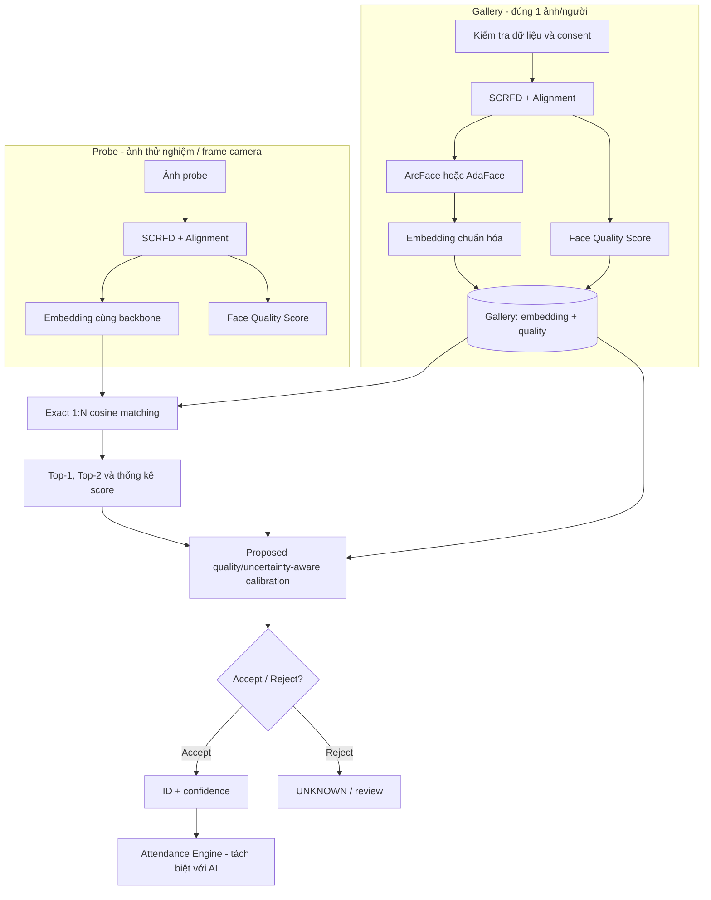

# KẾ HOẠCH NGHIÊN CỨU CHI TIẾT

> **Tiến độ mới nhất 29/10/2026:** đã hoàn tất AdaFace 15 epoch, đối chứng
> LVFace và ArcFace–AdaFace fusion/nested gallery (mục 25–27). Fusion có
> tín hiệu tăng ranking dev; chưa chứng minh cải thiện open-set rõ ràng,
> gate N300 40% chưa đạt. Test tiếp tục đóng; chưa đổi model production.

## Quality-Adaptive Confidence Calibration for Single-Shot Open-Set Face Identification

> **Mục tiêu:** Phát triển và kiểm chứng một phương pháp cải thiện độ tin cậy của nhận diện khuôn mặt **1:N**, **chỉ một ảnh đăng ký cho mỗi danh tính**, hướng tới bài báo trên tạp chí thuộc **Q3** (cần xác minh cách xếp hạng và tình trạng tạp chí tại thời điểm nộp).
>
> **Ngày lập:** 24/10/2026 · **Cập nhật:** 25/10/2026 (xem mục 20) · **Trạng thái:** Đã có baseline + representation rescue + risk–coverage; gate ~0,4 vẫn chưa đạt, đã chốt hướng **negative result có kiểm soát**; **SCface đã bỏ khỏi critical path** · **Ngôn ngữ:** Tiếng Việt.

---

## 0. Tóm tắt điều hành — các quyết định đã chốt

| Hạng mục | Quyết định / giả định làm việc |
|---|---|
| Ứng dụng đầu ra | Điểm danh / chấm công tự động, không cần nhập mã cá nhân |
| Quy mô danh tính | 100–1.000 người trong gallery |
| Dữ liệu đăng ký | Chính xác **01 ảnh thật cho mỗi người**; có thể tính nhiều đặc trưng từ cùng ảnh nhưng không bổ sung ảnh thật vào gallery |
| Bài toán khoa học | **Single-shot, open-set face identification**: người trong gallery và người ngoài gallery đều có thể xuất hiện |
| Backbone | ArcFace/InsightFace là baseline chính; AdaFace-R50 để so sánh và kiểm tra chất lượng ảnh thấp |
| Face detection + alignment | SCRFD + 5-point cho ảnh đủ lớn; QMUL dùng chip resize vì detector thất bại; mọi thay đổi chốt trên dev |
| Đề xuất nghiên cứu | **Quality-aware + uncertainty-aware confidence calibration**, tập trung vào cơ chế *accept / reject* có kiểm soát FPIR |
| Thước đo chính | **FNIR @ FPIR mục tiêu** (ưu tiên), thêm DIR, CMC/rank-1, DET, coverage/reject, latency, calibration |
| CSDL hệ thống demo | PostgreSQL + pgvector, **exact search** cho 100–1.000 vector 512 chiều; không cần HNSW lúc đầu |
| Thiết bị | **RTX 3060 Laptop 6 GB** (đã xác minh); Python 3.11.9; PyTorch 2.14.1+cu130; ONNX Runtime CPU |
| Lộ trình gợi ý | 16 tuần; đã hoàn thành tuần 0–2 (môi trường, protocol, baseline sơ bộ), representation rescue và risk–coverage; đang chuyển sang viết bản thảo negative result |
| Kết quả mong muốn | Mã tái lập, bảng baseline/ablation, phân tích lỗi, bản thảo bài báo, demo nhận diện 1:N |

**Lưu ý định hướng:** mục tiêu Q3 **không đồng nghĩa** bảo đảm được chấp nhận. Đóng góp phải có tính mới so với công trình trước, thiết kế đối chứng mạnh và kết quả có ý nghĩa thống kê. Không trình bày một tổ hợp thư viện có sẵn là “thuật toán mới”.

## 1. Bối cảnh, vấn đề và phạm vi

### 1.1. Bài toán gốc

- Một người chỉ nộp được **một ảnh chân dung** để đăng ký.
- Hệ thống camera nhận diện **1:N** trong cơ sở dữ liệu khoảng 100–1.000 danh tính.
- Trong ca làm/lớp học sẽ có **người chưa đăng ký**; hệ thống phải có kết quả `UNKNOWN`, không ép mọi khuôn mặt thành người đã đăng ký.
- Ảnh gallery có thể là ảnh chân dung chất lượng cao; ảnh probe từ camera thường chịu ảnh hưởng của góc mặt, ánh sáng, chuyển động, khoảng cách, camera khác nhau.
- Hậu quả của **nhận nhầm người lạ** là điểm danh/chấm công sai; cơ chế tránh false accept quan trọng hơn việc luôn trả về một tên.

### 1.2. Phạm vi nghiên cứu, không nhập nhằng

**Có trong nghiên cứu:** 1 ảnh/gallery ID; embedding; so khớp top-1/top-2; chất lượng ảnh; hiệu chỉnh độ tin cậy; open-set rejection; đánh giá khả năng tổng quát hóa giữa **camera/điều kiện chất lượng trong QMUL**; thực nghiệm theo quy mô gallery. External dataset ngoài QMUL/LFW chỉ là optional/future work.

**Chỉ là tầng ứng dụng hỗ trợ:** tài khoản, ca làm, check-in/out, trùng sự kiện, dashboard, xuất CSV/Excel, phân quyền.

**Không đặt làm đóng góp chính:** huấn luyện lại CNN nhận diện quy mô lớn từ đầu; tìm kiếm vector ANN ở gallery 1.000 người; face tracking đa camera; tạo ảnh tổng hợp rồi mặc nhiên coi đó là tăng lượng dữ liệu thật; anti-spoofing/deepfake nếu chưa có dataset và protocol riêng.

### 1.3. Thuật ngữ

- **Gallery/enrollment:** tập mẫu người đã đăng ký, đúng 1 ảnh/danh tính trong mỗi lần thí nghiệm.
- **Probe:** ảnh (hoặc frame) cần được định danh; khác ảnh gallery.
- **Mated probe:** probe thuộc một danh tính hiện diện trong gallery.
- **Non-mated probe:** probe thuộc người không có trong gallery.
- **Open-set 1:N:** tìm người phù hợp nhất và đồng thời được phép từ chối nếu không đủ bằng chứng.
- **Single-shot:** số ảnh *gallery* mỗi danh tính bằng 1; không có nghĩa chỉ được có 1 ảnh kiểm thử/danh tính.

## 2. Mục tiêu khoa học và câu hỏi nghiên cứu

### 2.1. Mục tiêu tổng quát

Xây dựng **cơ chế hiệu chỉnh điểm tin cậy có xét đến chất lượng ảnh và độ bất định khi so khớp**, nhằm cải thiện nhận diện mở 1:N với một ảnh đăng ký/danh tính, đặc biệt dưới thay đổi chất lượng giữa ảnh đăng ký và camera.

### 2.2. Câu hỏi nghiên cứu (RQ)

| Mã | Câu hỏi | Cách trả lời |
|---|---|---|
| RQ1 | Khi chỉ một ảnh gallery, chất lượng gallery/probe ảnh hưởng thế nào đến FPIR/FNIR? | Phân tầng chất lượng và camera, báo cáo đường DET |
| RQ2 | Hiệu chỉnh dựa trên `top1`, `top1-top2`, chất lượng gallery/probe có tốt hơn ngưỡng cosine thuần túy không? | Ablation và so sánh trên cùng backbone |
| RQ3 | Phương pháp học trên danh tính phát triển có tổng quát sang **danh tính chưa gặp** và **điều kiện camera/chất lượng khác trong QMUL** không? | Identity-disjoint; phân tầng camera/chất lượng; cross-dataset là optional/future work |
| RQ4 | Lợi ích về nhận diện có đáng đánh đổi thêm độ trễ/chi phí tính toán không? | P50/P95 latency, throughput, VRAM/CPU |
| RQ5 | Khi tăng N từ 100 lên 1.000, các ngưỡng và độ tin cậy có ổn định không? | Thử nhiều kích thước gallery + seed |

### 2.3. Giả thuyết kiểm định trước thí nghiệm

- **H1:** Phương pháp đề xuất làm **giảm FNIR tại cùng mức FPIR** so với ngưỡng cosine tối ưu trên validation, trong ít nhất hai bối cảnh camera/chất lượng.
- **H2:** Sử dụng **cả chất lượng gallery lẫn probe** có thể hữu ích hơn chỉ sử dụng điểm tương đồng hoặc chất lượng probe.
- **H3:** Cơ chế mới vẫn duy trì hiệu quả khi gallery tăng từ 100 đến 1.000 danh tính.
- **H4 (phụ):** Chi phí suy luận bổ sung đủ nhỏ để không ảnh hưởng đáng kể tính khả thi chấm công.

Các giả thuyết **có thể bị bác bỏ**. Không đặt mức tăng giả định thành “kết quả”. Có thể xem mức giảm FNIR tương đối ≥10% tại FPIR cố định là một **mục tiêu nội bộ** để quyết định có đáng tiếp tục viết bài, không phải điều kiện chung của Q3.

## 3. Khoảng trống và tính mới cần xác minh

### 3.1. Những gì đã có (không được nhận là mới)

1. **ArcFace**: embedding phân biệt danh tính bằng additive angular margin.
2. **AdaFace (CVPR 2022)**: huấn luyện nhận diện thích ứng chất lượng ảnh.
3. **CR-FIQA (CVPR 2023)**: ước lượng mức độ hữu ích của ảnh đối với nhận diện.
4. **Open-set thresholding / calibration**: ngưỡng cosine, top-k score/margin, Platt/logistic/isotonic calibration đã là kỹ thuật phổ biến.
5. Công trình **Energy-Guided Distribution Calibration for Open-Set Few-Shot Face Recognition (Zhou et al., Electronics 09/2026)** dùng BEDCM: pseudo-label + distribution calibration + boundary-unknown augmentation + energy margin, gallery **k-shot**, thực nghiệm CASIA/IJB-C, tối ưu ở FAR 0,1%/1%. Đây là **training-time calibration**, không phải single-shot low-res và không mô hình hóa quality gap gallery–probe. Không được claim "first" về calibration/threshold sensitivity; phải định vị khác biệt ở single-shot, low-resolution surveillance, post-hoc, N-aware.
6. **Open-Scenario Face Recognition System Based on Dynamic Quality Awareness and Trajectory-Level Fusion (Li et al., ICSP 2026)** là hệ **video/trajectory**, quality dùng để chọn frame (sharpness/scale/pose), fusion theo thời gian + margin rejection. Khác single-image one-shot và không có calibration theo N/FPIR; dùng làm related work cho quality-aware video, không phải đối thủ trực tiếp.

### 3.2. Hướng đóng góp có thể nghiên cứu

**Phương án A — Đề xuất chính, rủi ro vừa:** *Gallery–Probe Quality Discrepancy-Aware Calibration*

- Không chỉ dùng riêng điểm chất lượng gallery/probe mà mô hình hóa **độ lệch chất lượng** và sự tương tác giữa độ lệch đó với phân bố điểm Top-2.
- Đo hiệu quả theo **FPIR được giữ cố định** trên validation; kiểm tra khả năng tổng quát hóa khi đổi camera và gallery size.
- Xây dựng quy tắc từ chối có thể giải thích (score, margin, quality-gap, outlier), kèm đánh giá uncertainty/calibration.

**Phương án B — Nếu A không vượt baseline:** *Gallery-size-aware risk calibration*

- Nghiên cứu tác động của quy mô gallery đến score cực đại của người lạ.
- Thử hiệu chỉnh score hoặc ngưỡng dựa vào **N** và phân phối impostor từ tập development; vẫn giữ nguyên tập test để đánh giá.

**Phương án C — Phần mở rộng không bắt buộc:** *Adaptive probe frame selection*

- Chỉ lấy một ảnh gallery nhưng dùng nhiều frame camera trong **một lượt xác minh**, chọn frame theo chất lượng và độ ổn định.
- Đây là nhánh mở rộng thứ cấp; nếu làm bài báo về single-image probe thì phải báo cáo riêng, không trộn kết quả.

### 3.3. Gate kiểm tra novelty

Trước khi viết phương pháp mới: làm **literature matrix ít nhất 20–30 bài** (ưu tiên 2022–10/2026), với cột `paper | year | gallery shots | open/closed set | backbone | quality | calibration | dataset | metric | limitation`. Tìm cả các từ khóa `quality-aware open-set face recognition`, `single-shot watchlist identification`, `face recognition score normalization`, `OOD rejection`, `uncertainty-calibrated face recognition`, `adaptive decision threshold`. Nếu thấy phương pháp tương đương, điều chỉnh câu hỏi hoặc tính mới ngay.

## 4. Pipeline toàn diện

### 4.1. Quy trình nghiên cứu cốt lõi (một ảnh mỗi danh tính)



**Quy tắc:** Không cập nhật embedding gallery từ probe test trong lúc đánh giá. Nếu thử template adaptation, phải xem là thí nghiệm khác và kiểm soát data leakage.

### 4.2. Hai tầng tách biệt

- **Tầng nghiên cứu:** file protocol, embedding, matching, calibration, metrics, plots, ablation. Không phụ thuộc PostgreSQL hay giao diện web.
- **Tầng demo:** webcam → detection → quality gate → liveness độc lập (nếu có) → model nghiên cứu → accept/reject → FastAPI → PostgreSQL → React. Không dùng kết quả anti-spoofing để thay chỉ số nhận diện mặt nếu chưa có protocol PAD.

## 5. Lựa chọn model và môi trường

| Thành phần | Lựa chọn | Mục đích |
|---|---|---|
| Detector | SCRFD | Nhanh, ổn định; cố định model, kích thước đầu vào và ngưỡng |
| Alignment | 5-point similarity transform | Đưa mặt về chuẩn chung; kiểm tra RGB/BGR đúng model |
| Recognition baseline #1 | ArcFace pretrained (ví dụ r50) | Baseline chính 512D |
| Recognition baseline #2 | AdaFace-R50 pretrained | So sánh trong tình huống chất lượng thấp |
| Quality baseline | CR-FIQA nếu có quyền dùng trọng số; các proxy blur/pose/brightness để đối chứng | Chất lượng nhận diện chứ không chỉ độ nét |
| Calibration baseline | Threshold; top1+margin; logistic regression; isotonic/Platt khi phù hợp | Tránh đối chứng quá yếu |
| Proposed module | MLP nhỏ hoặc mô hình có cấu trúc/đơn điệu kết hợp `s1`, margin, `q_g`, `q_p`, Δquality | Nghiên cứu, phải chứng minh tính mới |
| Experiment | PyTorch, NumPy, SciPy, scikit-learn, pandas, MLflow/TensorBoard | Tái lập |
| Runtime demo | ONNX Runtime, FastAPI, PostgreSQL + pgvector, React | Triển khai |

**Nguyên tắc so sánh:** Không trộn embedding của ArcFace và AdaFace trong cùng gallery trực tiếp. Mỗi backbone cần trích xuất gallery/probe riêng; đánh giá cùng split và metric.

**Giấy phép:** Mã nguồn InsightFace có thể dùng theo MIT, nhưng **pretrained model được cung cấp qua dự án mặc định có điều kiện non-commercial research**; phải kiểm tra và xin giấy phép thích hợp trước triển khai thương mại. Tương tự kiểm tra điều khoản dataset và các checkpoint AdaFace/CR-FIQA.

## 6. Dữ liệu và quy tắc chia tập (quan trọng nhất)

### 6.1. Bộ dữ liệu đề xuất

| Dataset | Vai trò | Hạn chế / protocol |
|---|---|---|
| **QMUL-SurvFace** | Benchmark chính với ảnh giám sát, open-set; đủ danh tính để chọn gallery 1.000 | Dùng *custom one-image-gallery protocol* và công bố rõ là **khác official benchmark** nếu official có nhiều ảnh/gallery ID |
| **SCface** | **Không dùng trong critical path**; external test tùy chọn/future work | Chỉ 130 người, 4.160 ảnh; cần cover letter + release agreement do full-time staff ký; không đủ cho N=1.000 hoặc FPIR=0,001 |
| **Tập webcam nội bộ tùy chọn** | Demo thực tế, kiểm tra độ trễ & domain shift | Thu với đồng ý rõ ràng; không đồng nhất với benchmark nghiên cứu |
| Dataset bổ sung đã được cấp quyền | External sanity check tùy chọn; không chặn timeline | Chỉ dùng nếu thật sự có thể truy cập, đúng license, đủ ảnh / danh tính; không thay thế QMUL |

**Quyết định phạm vi (24/10/2026):** SCface **không nằm trong critical path** vì chỉ có 130 danh tính, không đủ cho N=500/1.000 hoặc FPIR=0,001, và thủ tục truy cập cần chữ ký của full-time staff. Benchmark chính là **QMUL-SurvFace custom one-shot**; LFW chỉ là sanity check. Mọi external test khác là optional/future work và **không được dùng để claim cross-dataset generalization** nếu chưa thực sự chạy.

Số liệu tham khảo từ trang QMUL-SurvFace: **15.573 danh tính và 463.507 ảnh**, trong đó có 5.319 multi-shot ID ở test theo protocol gốc và 4.935 single-shot ID dùng làm nhóm nonmate; phải đọc tài liệu trước khi tạo custom split.

### 6.2. Quy định chống data leakage

1. **Danh tính development và test phải tách rời**, không để cùng người xuất hiện trong hai nhóm khi học calibration hoặc chọn ngưỡng.
2. Trên development, tạo các episode 1 ảnh gallery/ID để học calibration; phần còn lại là mated probes; danh tính ngoài gallery tạo non-mated probes.
3. Trên test, tạo gallery độc lập gồm **đúng 1 ảnh/ID**; các ảnh còn lại tạo mated probes; người ngoài gallery làm non-mated probes.
4. Cùng bộ camera/video có frame gần trùng nhau: chia theo **session/recording** và danh tính khi có thể; tránh để frame liên tiếp ở train và test.
5. Các tham số ngưỡng, chuẩn hóa chất lượng, hyperparameter, chọn mô hình được xác định **trên development**. Test chỉ dùng để báo cáo cuối.
6. Nếu backbone đã pretrained trên danh tính của test dataset mà không có cách loại trừ, ghi rõ **rủi ro overlap**; tìm model/data cho phép kiểm soát overlap hoặc đánh giá ngoại bộ và nêu hạn chế.
7. Không chọn ngẫu nhiên từng ảnh rồi split trước khi chia danh tính; dễ rò rỉ identity.
8. Ghi lại `gallery_id`, `probe_id`, `person_id_hash`, `camera_id`, `session_id`, `seed`, `split`, `quality`, `model_version`.

### 6.3. Protocol mẫu lặp lại nhiều lần

- Quy mô gallery: **N = 100, 300, 500, 1.000** (với dataset đủ danh tính).
- Random seed cố định trước: ví dụ **2026, 2027, 2028, 2029, 2030**; có thể tăng số seed khi tính toán cho phép.
- Gallery: chọn **một ảnh** cho mỗi ID, quy định ưu tiên chất lượng/chính diện hoặc chọn ngẫu nhiên **trước khi nhìn kết quả**; làm hai protocol để phân biệt tốt/xấu.
- Mated probes: những ảnh khác gallery của các ID đã đăng ký; non-mated probes: từ ID hoàn toàn không nằm trong gallery.
- Cần **số lượng non-mated probes đủ lớn** nếu báo cáo FPIR rất thấp. Với cỡ mẫu nhỏ, tỷ lệ 0 giả báo động không chứng minh FPIR=0; báo cáo khoảng tin cậy.
- Có thể chạy thử tỷ lệ mated/non-mated khác nhau, nhưng **FPIR/FNIR phải báo cáo theo nhóm đúng mẫu số**, không dùng accuracy tổng thể để che mất class imbalance.
- Báo cáo theo camera, chất lượng, góc mặt, khoảng cách, giới hạn chất lượng ảnh; phân tích failure cases.

## 7. Thuật toán và mô hình học

### 7.1. Baseline (đối chứng bắt buộc)

Với embedding L2-normalized `e` và gallery `g_j`:

\[
s_j = e^\top g_j;\qquad s_1 = \max_j s_j;\quad s_2 = \text{điểm lớn thứ hai}.
\]

Baseline **B0**: nhận danh tính `argmax` nếu `s1 >= τ`, ngược lại `UNKNOWN`. Ngưỡng `τ` lấy từ tập validation để đạt mức FPIR mục tiêu (không dùng test để chọn).

Baseline **B1**: `s1` + `Δ = s1 - s2`, quy tắc/tập tham số học trên development.

Baseline **B2**: logistic regression/MLP chỉ dùng `s1`, `Δ` và thống kê phân bố scores (không có quality).

Baseline **B3**: quality-aware score calibration có sẵn hoặc mô hình nhỏ dùng `s1`, `Δ`, `q_p`, `q_g`.

Baseline **B4**: lặp lại B0–B3 với AdaFace (tối thiểu B0, B3), cùng split.

### 7.2. Prototype phương pháp nghiên cứu

Đặt vector đặc trưng mức **candidate search**:

\[
x=[s_1,\ s_1-s_2,\ q_p,\ q_{g^*},\ |q_p-q_{g^*}|,\ N,\ \mu_{neg},\ \sigma_{neg}].
\]

- `g*`: ứng viên top-1; `q_g*` là quality của **ảnh đăng ký ứng viên đó**.
- `μ_neg, σ_neg` (nếu dùng): thống kê score với negatives từ development/score distribution, không lấy từ nhãn test.
- `N`: kích thước gallery; phải kiểm tra khả năng tổng quát N chưa thấy.

Bước 1: học `Cθ(x)` ước lượng xác suất **top-1 là danh tính đúng** hoặc điểm rủi ro (định nghĩa nhãn phải rõ ràng; unknown và wrong-ID đều mang nhãn âm).

Bước 2: **calibrate** bằng tập validation/OOF predictions nếu cần (temperature/Platt/isotonic/conformal-like reject tùy nghiên cứu) và chọn ngưỡng để đáp ứng FPIR mục tiêu.

Bước 3: khi suy luận, lấy top-1 + top-2, tính `x`, nhận `Cθ(x)`, cho `ACCEPT` nếu đạt ngưỡng, còn lại `UNKNOWN/REVIEW`.

> Đây là **khung thuật toán nghiên cứu**, không được tuyên bố mới cho đến khi literature review chứng minh rõ khác biệt. Chỉ thêm một MLP vào cosine **không tự động** là đóng góp khoa học.

### 7.3. Các phiên bản thí nghiệm có thể sáng tạo

- **P1 – Quality Gap Interaction:** thêm các tương tác có chủ đích giữa `quality gap`, `margin`, `s1` và phân phối impostor, nghiên cứu vì sao chúng giúp so khớp khác camera.
- **P2 – Risk-Constrained Thresholding:** tối ưu FNIR dưới ràng buộc FPIR trên development; đánh giá mức ổn định trên test.
- **P3 – N-Aware Score Normalization:** học sự thay đổi của max impostor score theo N, so với ngưỡng cố định/hiệu chỉnh thuần.
- **P4 (mở rộng) – Adaptive Frame Selection:** dùng nhiều probe frame trong một phiên, không thay đổi quy tắc một ảnh gallery; cần protocol video độc lập.

**Chọn một phiên bản làm đóng góp chính**, tránh gom quá nhiều kỹ thuật khiến khó phân tích nguyên nhân cải thiện.

### 7.4. Pseudocode ngắn

```python
def identify_open_set(probe_image, gallery, detector, encoder, quality_model, calibrator, threshold):
    face = detector.detect_one_and_align(probe_image)
    if face is None or not face.quality_gate_pass:
        return {"status": "REVIEW", "reason": "no_valid_face"}

    e = l2_normalize(encoder(face.crop))
    scores = gallery.normalized_embeddings @ e
    top_idx = scores.argsort()[-2:][::-1]
    i1, i2 = map(int, top_idx)
    s1, s2 = float(scores[i1]), float(scores[i2])
    qp = quality_model(face.crop)
    qg = gallery.qualities[i1]
    features = build_features(s1, s2, qp, qg, len(gallery))
    confidence = float(calibrator(features))

    if confidence < threshold:
        return {"status": "UNKNOWN", "confidence": confidence}
    return {"status": "ACCEPT", "person_id": gallery.ids[i1], "confidence": confidence}
```

*Lưu ý:* pseudocode giả định có quality gate; **liveness** là module riêng, chưa có trong đoạn trên. Không dùng confidence học từ dữ liệu để gọi là xác suất đúng nếu chưa kiểm tra calibration.

## 8. Chỉ số đánh giá và thống kê

### 8.1. Chính

- **FPIR (False Positive Identification Rate):** tỷ lệ non-mated probes được gán nhầm thành người thuộc gallery.
- **FNIR (False Negative Identification Rate):** tỷ lệ mated probes không trả về đúng danh tính vượt ngưỡng (bao gồm từ chối và chọn sai theo định nghĩa protocol).
- **FNIR @ FPIR ∈ {0,01; 0,001}** nếu cỡ mẫu nonmate đủ lớn; chọn mức nào đủ tin cậy dựa trên số mẫu và mục tiêu nghiệp vụ.
- **DIR @ FPIR** và **rank-1 identification** cho phân tích phụ.

### 8.2. Bổ sung

- DET/ROC theo đúng open-set protocol; đường risk–coverage (accepted/rejected).
- ECE/Brier/reliability diagram chỉ khi output được diễn giải là confidence/probability và có nhãn phù hợp.
- Latency P50/P95 tách từng bước: decode, detect/align, quality, embedding, matching, calibration; GPU peak VRAM; throughput.
- Fairness/slice performance nếu dữ liệu và giấy phép cho phép: ánh sáng, camera, góc, độ phân giải; không tự suy đoán thuộc tính nhạy cảm từ gương mặt.

### 8.3. Ý nghĩa thống kê

- Lặp lại gallery sampling với nhiều seed; cung cấp **mean ± std hoặc CI 95%**.
- Bootstrap theo **danh tính hoặc session**, không chỉ bootstrap từng frame có tương quan.
- So sánh **paired** trên cùng probe/gallery split; trình bày cỡ hiệu ứng, không chỉ p-value.
- Không sửa threshold theo test rồi báo cáo như kết quả holdout.

## 9. Ma trận thí nghiệm và Ablation Study

| ID | Thí nghiệm | Đầu ra cần có |
|---|---|---|
| E00 | Kiểm tra detector/alignment và loại ảnh hỏng | Chất lượng ảnh, tỷ lệ failure, nhật ký |
| E01 | ArcFace B0 (cosine threshold) | Baseline chính và DET |
| E02 | AdaFace B0 | Baseline backbone thứ hai |
| E03 | ArcFace với top1 + top2 margin | Tác dụng margin |
| E04 | ArcFace + quality probe | Tác dụng `q_p` |
| E05 | ArcFace + quality gallery | Tác dụng `q_g` |
| E06 | ArcFace + quality gap | Tác dụng `|q_p-q_g|` |
| E07 | Calibration không quality (LR/MLP) | Đối chứng sức mạnh của classifier nhỏ |
| E08 | Proposed method đầy đủ | Main result |
| E09 | Đánh giá N=100/300/500/1000 | Gallery-size robustness |
| E10 | Camera/quality shift trong QMUL; E10b external dataset nếu có | Kiểm tra tổng quát hóa nội bộ; E10b optional, không chặn timeline |
| E11 | Ablation bỏ từng thành phần và thay model quality | Giải thích đóng góp |
| E12 | 5 seed + paired CI, error analysis | Tính ổn định và ý nghĩa thống kê |
| E13 | Latency trên RTX 3060 và CPU | Khả năng triển khai |
| E14 (tùy chọn) | Video temporal fusion riêng | Mở rộng nhưng không làm sai single-shot gallery |

**Điều kiện so sánh công bằng:** Cùng gallery IDs/ảnh, same probe split, same detection, same model weights (khi so sánh chỉ riêng calibrator), cùng tiêu chí ngưỡng validation, cùng FPIR mục tiêu.

### 9.1. Các bảng/hình dự kiến trong bài báo

1. **Table 1:** Datasets, IDs, #gallery, #mated probes, #nonmated probes, cameras, protocol.
2. **Table 2:** Main results FNIR@FPIR theo N, 2 backbone, khoảng tin cậy.
3. **Table 3:** Ablation `s1`, `margin`, `qp`, `qg`, `gap`, `N`.
4. **Table 4:** Latency, VRAM, CPU/GPU throughput.
5. **Figure 1:** Pipeline nghiên cứu và scoring.
6. **Figure 2:** DET / risk–coverage.
7. **Figure 3:** Performance theo quality gap và camera.
8. **Figure 4:** Calibration/reliability hoặc case studies (ẩn danh).

## 10. Phân công máy: local vs Colab/Kaggle

### 10.1. Trạng thái máy local

- RTX 3060 **Laptop, 6.144 MiB**, driver 621.01; đã chạy được R50 batch 64 với
  AMP, khoảng 4–5 phút/epoch trên 78,7k ảnh.
- Máy local đủ cho inference, embedding 4.000 ảnh, evaluation, calibration và
  smoke test; **không dùng để train dài**.
- Chi tiết runbook: `single-shot-open-set-fr/docs/cloud_training.md`.

### 10.2. Quy tắc phân công (bắt buộc)

**Việc nhanh, lặp lại, cần đọc kết quả ngay → local. Việc train dài, nhiều seed,
nhiều cấu hình, cần VRAM lớn → Colab/Kaggle.**

Mốc thực tế: **~20–30 phút**.

| Công việc | Nơi chạy |
|---|---|
| Sửa code, test, tạo manifest, kiểm tra dữ liệu | Local |
| Smoke test 1 epoch subset nhỏ / 100–200 step | Local |
| Trích embedding 4.000 ảnh, rank-1, bootstrap CI | Local |
| B0/B2/B3/P1, FNIR/FPIR, quality strata, hình, docs | Local |
| Chạy test một lần sau freeze cấu hình | Local |
| Full fine-tune R50/AdaFace/R100 | Colab/Kaggle |
| 20+ epoch, nhiều seed, hyperparameter sweep | Colab/Kaggle |
| Super-resolution/alignment model, mask-consistency | Colab/Kaggle |
| Subset N=1.000, ensemble nhiều backbone | Colab/Kaggle |

Quy tắc cứng:

- Ước tính **> 20–30 phút**, cần **> 1 lần chạy**, hoặc có nguy cơ **OOM** →
  chuyển cloud.
- Trên cloud vẫn phải chạy smoke test trước; không đốt quota cho full run khi
  chưa xác nhận đường dẫn/VRAM/checkpoint.
- Không train dài trên laptop nữa. Các run R50 15 epoch vừa qua là ngoại lệ đã
  hoàn tất.
- Không chạy test trên cloud và không dùng test để chọn checkpoint/TTA.

### 10.3. License gate trước khi upload

- QMUL-SurvFace là **research-only**; InsightFace pretrained là
  **non-commercial research**.
- **Không upload QMUL, ảnh, embedding hoặc checkpoint lên repo public.**
- Chỉ dùng private Google Drive / private Kaggle dataset / cloud của trường nếu
  license hoặc văn bản cho phép. Nếu chưa rõ: giữ dữ liệu local hoặc dùng GPU
  của trường; cloud chỉ dùng để phát triển code, không chứa dữ liệu thật.
- **25/10/2026:** người dùng xác nhận license cho phép dùng QMUL/InsightFace
  trong phạm vi nghiên cứu private trên cloud. Vẫn **không** upload public;
  lưu email/văn bản xác nhận, người xác nhận, phạm vi và nơi lưu dữ liệu trước
  khi chạy job đầu tiên.
- Ghi lại ngày kiểm tra license, người xác nhận, nơi lưu dữ liệu và quyền truy
  cập trước khi chạy job đầu tiên.

### 10.4. Quy trình cloud

1. Chốt git commit, requirements, seed, manifest, epochs, batch size, margin.
2. Đưa code lên cloud; dữ liệu để riêng trong private storage nếu được phép.
3. Smoke test 100–200 step hoặc 1 epoch subset nhỏ; xác nhận `last.pt` được ghi.
4. Full run với `--out` trỏ persistent storage; script lưu `last.pt` mỗi epoch
   và `best.pt` khi dev rank-1 cải thiện.
5. Nếu session bị ngắt, resume bằng `--resume .../last.pt` (cùng manifest, cùng
   tổng số epoch).
6. Tải `best.pt`, `w600k_r50.onnx`, `training_log.csv`, `train_summary.json` về
   local; evaluation/calibration/test chạy local.

### 10.5. Colab và Kaggle

- **Colab:** mount Google Drive, ghi output vào `/content/drive/...`; session và
  GPU free không ổn định, phải có checkpoint. Chỉ dùng private Drive nếu license
  cho phép.
- **Kaggle:** dùng private dataset, output vào `/kaggle/working/...`; quota GPU
  theo tuần và giới hạn session/output, kiểm tra tại thời điểm chạy. Chỉ dùng
  private dataset nếu license cho phép.
- Không giả định free tier luôn có GPU; không lưu artifact duy nhất trong
  `/content` hoặc thư mục tạm.

### 10.6. Việc cần làm ngay

- [x] Kiểm tra license QMUL/InsightFace cho việc xử lý trên Colab/Kaggle private
  (người dùng xác nhận 25/10/2026; lưu văn bản gốc).
- [ ] Không train dài local; chỉ chạy smoke test nếu cần sửa script.
- [x] Hoàn thiện risk–coverage/negative result trên local.
- [ ] Chỉ lên cloud khi có giả thuyết rõ (AdaFace/R100, mask-consistency,
  alignment mặt nhỏ, super-resolution), không chạy thêm cùng công thức R50.
- [ ] Nếu lên cloud: dùng `docs/cloud_training.md`, lưu `last.pt`, và mang
  `best.pt`/ONNX/log về local để đánh giá.

### 10.7. Reproducibility

- Lưu git commit, GPU/driver, CUDA/PyTorch, dataset checksum, seed, config.
- Không commit ảnh, embedding, manifest có ID thật hoặc checkpoint.
- Cache embedding theo `model_version + preprocessing_version + image_checksum`.
- Mỗi run cloud phải có `training_log.csv` và `train_summary.json`; thiếu log
  thì không dùng kết quả.

## 11. Cấu trúc mã nguồn đề xuất

```text
single-shot-open-set-fr/
├── README.md
├── LICENSE
├── docs/
│   ├── protocol.md
│   ├── literature_matrix.csv
│   ├── research_notes.md
│   ├── representation_rescue.md
│   ├── cloud_training.md
│   └── ethics_data_governance.md
├── configs/
│   ├── arcface.yaml
│   ├── adaface.yaml
│   ├── benchmark_n100.yaml
│   └── benchmark_n1000.yaml
├── src/
│   ├── data/{splits.py,manifest.py,quality_checks.py}
│   ├── face/{detect_align.py,backbones.py,quality.py}
│   ├── matching/{cosine.py,topk.py,score_normalization.py}
│   ├── calibration/{features.py,logistic.py,mlp.py,proposed.py}
│   ├── evaluation/{openset.py,metrics.py,bootstrap.py,plots.py}
│   └── demo/{app.py,attendance.py,pipeline.py,service.py,store.py,postgres_store.py,static/}
├── experiments/
│   ├── E01_baseline.ipynb
│   ├── E08_proposed.ipynb
│   └── E11_ablation.ipynb
├── tests/
│   ├── test_split_integrity.py
│   ├── test_single_gallery_image.py
│   ├── test_metric_denominators.py
│   └── test_no_test_threshold_tuning.py
├── scripts/
│   ├── prepare_data.py
│   ├── extract_embeddings.py
│   ├── train_calibrator.py
│   ├── evaluate.py
│   └── make_paper_tables.py
├── outputs/                 # .gitignore, không đẩy dữ liệu nhạy cảm
└── paper/
    ├── outline.md
    ├── related_work.md
    └── figures/
```

### 11.1. Tách dữ liệu và artifact

- **Ảnh gốc:** thư mục ngoài Git, mã hóa và cấp quyền truy cập.
- **Manifest:** mã ID được băm, nguồn dữ liệu, quyền sử dụng, split, camera, checksum.
- **Embeddings:** `.npz`/Parquet/DB có phiên bản model; vẫn được coi là dữ liệu nhạy cảm.
- **Experiment result:** CSV/JSON chỉ chứa kết quả tổng hợp và IDs giả danh; tối ưu cho tái lập.

## 12. Thiết kế CSDL để làm demo sau nghiên cứu

Với 1.000 vector 512D, có thể tính toàn bộ cosine similarity trên CPU với NumPy hoặc truy vấn PostgreSQL/pgvector **exact**, không cần HNSW ở giai đoạn này. Tách hệ dữ liệu benchmark khỏi hệ dữ liệu điểm danh thật.

**MVP 27/10/2026:** local mặc định dùng SQLite + exact search trong Python
(`src/demo/store.py`); Docker dùng PostgreSQL 16 + pgvector
(`src/demo/postgres_store.py`) với exact search `<=>`. Schema dưới đây là schema
đang dùng trong Docker; SQLite chỉ là fallback local.

```sql
CREATE EXTENSION IF NOT EXISTS vector;

CREATE TABLE persons (
    person_id BIGSERIAL PRIMARY KEY,
    external_code VARCHAR(64) UNIQUE NOT NULL,
    display_name TEXT NOT NULL,
    active BOOLEAN NOT NULL DEFAULT TRUE
);

CREATE TABLE face_templates (
    template_id BIGSERIAL PRIMARY KEY,
    person_id BIGINT NOT NULL UNIQUE REFERENCES persons(person_id),
    embedding VECTOR(512) NOT NULL,
    quality_score REAL,
    model_version VARCHAR(100) NOT NULL,
    created_at TIMESTAMPTZ NOT NULL DEFAULT NOW()
);

CREATE TABLE attendance_events (
    event_id BIGSERIAL PRIMARY KEY,
    person_id BIGINT REFERENCES persons(person_id),
    device_id TEXT NOT NULL,
    event_time TIMESTAMPTZ NOT NULL DEFAULT NOW(),
    decision TEXT NOT NULL CHECK (decision IN ('ACCEPT','UNKNOWN','REVIEW','REJECTED')),
    confidence REAL,
    model_version TEXT,
    reason TEXT
);

-- Khi query_embedding là VECTOR(512), tìm top-2 exact:
SELECT person_id,
       1 - (embedding <=> :query_embedding) AS cosine_similarity
FROM face_templates
ORDER BY embedding <=> :query_embedding
LIMIT 2;
```

**Không ghi sự kiện `UNKNOWN` vào `person_id` ngẫu nhiên.** Xử lý chống điểm danh trùng ở tầng attendance engine (theo người, ca làm, vị trí, khoảng thời gian); chỉ ghi `ACCEPT` khi vừa vượt kiểm tra danh tính và điều kiện an toàn.

## 13. Lộ trình chi tiết 16 tuần và tiêu chí nghiệm thu

| Tuần | Công việc | Deliverable | Gate để qua bước |
|---|---|---|---|
| 1 | Khảo sát 20–30 bài; chốt RQ và novelty map | `literature_matrix.csv`, 1 trang novelty | Biết rõ 3–5 đối chứng gần nhất |
| 2 | Xác minh license dataset/model; kiểm tra VRAM, codebase | `environment.yml`, data governance | Có nguồn dữ liệu truy cập hợp lệ |
| 3 | Tạo protocol, manifest, identity-disjoint split | `protocol.md`, tests | 1 gallery photo/ID, không leakage |
| 4 | SCRFD+ArcFace, cache embedding, cosine B0 | Result E01 | Tái lập trên 2 seed |
| 5 | AdaFace B0 và quality estimation | E02, quality audit | Pipeline RGB/BGR đúng và có logging |
| 6 | Metrics FPIR/FNIR, threshold validation, DET | E01–E03 plots | Đúng mẫu số mated/non-mated |
| 7 | Baseline hiệu chỉnh logistic, MLP, quality | E04–E07 | Có đối chứng đủ mạnh |
| 8 | Thiết kế proposed P1, kiểm tra dữ liệu phát triển | Prototype + objective | Không dùng nhãn test |
| 9 | Huấn luyện P1, điều chỉnh theo development | E08 | Có cải thiện sơ bộ hoặc ghi lý do thất bại |
| 10 | Ablation và quality-gap analysis | E11 | Phân biệt tác dụng từng thành phần |
| 11 | Gallery scaling 100/300/500/1000 | E09 | Kết quả nhiều seed có CI |
| 12 | Camera/quality shift trên QMUL (E10); external dataset optional (E10b) | Chứng minh tổng quát hóa nội bộ; E10b không chặn timeline |
| 13 | Latency, failure analysis, sanity checks | E12–E13 | Reproducible, không test tuning |
| 14 | Viết Method, Experiments, Related Work | Bản thảo v1 | Chứng minh novelty rõ ràng |
| 15 | Vẽ bảng/hình, đọc phản biện nội bộ, sửa lỗi | Bản thảo v2 | Thống kê/giấy phép/đạo đức đầy đủ |
| 16 | Chọn journal theo scope/Q index, hoàn thiện submission | Manuscript + reproducibility package | Chỉ nộp khi đủ kết quả; không bảo đảm Q3 |

**Nhánh dừng/đổi hướng:**

- Không có dataset phù hợp → ưu tiên xin quyền dùng hoặc đổi scope, **không tự thu thập trái phép**.
- E08 không thắng baseline mạnh → xem xét P2 N-aware calibration hoặc chất lượng gallery/probe khác domain; không che giấu kết quả âm.
- Dữ liệu nonmate quá ít để đo FPIR thấp → chọn operating point thực tế hơn và báo cáo CI.
- Không tìm được novelty thực sự → biến thành báo cáo benchmark/system paper phù hợp venue khác, thay vì cố ghi claim sai.

## 14. Checklist theo từng cột mốc

### Mốc A — trước khi huấn luyện

- [ ] Xác minh chính xác VRAM (`nvidia-smi`).
- [ ] Lập danh sách 20–30 paper và novelty matrix.
- [ ] Có quyền dùng dataset và pretrained checkpoints.
- [ ] Tài liệu giao thức gallery-one-shot được viết, test bằng unit test.
- [ ] Development/test tách danh tính; không tuning trên test.
- [ ] Đặt trước operating point FPIR và phương pháp bootstrap.

### Mốc B — baseline hoàn chỉnh

- [ ] ArcFace + cosine + UNKNOWN hoạt động.
- [ ] AdaFace baseline và color-space preprocessing được kiểm chứng.
- [ ] Quality scores có kiểm định phân bố theo camera/chất lượng.
- [ ] Top-2 sorting đúng; không dùng top-1 bắt buộc nhận diện.
- [ ] Có bảng kết quả theo N và 5 seed.
- [ ] Có log detector failures và tỷ lệ ảnh bị từ chối.

### Mốc C — phương pháp mới

- [ ] Định nghĩa và công thức phương pháp rõ ràng.
- [ ] Có **baseline hiệu chỉnh** đủ mạnh, không chỉ ngưỡng cố định.
- [ ] Ablation chứng minh từng thành phần có/không có giá trị.
- [ ] Không rò rỉ nhãn test/subject vào calibrator.
- [ ] Kết quả độc lập trên tập/camera khác nếu có thể.
- [ ] CI/seed và failure analysis đầy đủ.

### Mốc D — bài báo

- [ ] Title/abstract không quảng cáo quá mức.
- [ ] Related Work cập nhật đến thời điểm nộp.
- [ ] Nêu rõ protocol tự xây khác protocol gốc nếu có.
- [ ] Dataset/license/privacy/IRB hoặc thủ tục đạo đức được giải quyết theo quy định áp dụng.
- [ ] Số bảng/hình tương ứng với result CSV có thể tái tạo.
- [ ] Journal scope, indexing, quartile **theo năm và ngành** được xác minh trực tiếp.
- [ ] Kiểm tra phí xuất bản, thời gian phản biện, chính sách AI và dữ liệu của journal.

## 15. Bảo mật, đạo đức và pháp lý

- Chỉ sử dụng dataset theo điều kiện chủ sở hữu; ảnh sinh trắc học và embedding là dữ liệu nhạy cảm, không mặc định được đưa lên dịch vụ public/cloud.
- Với người tham gia thu ảnh nội bộ, cần thông tin minh bạch mục đích, phạm vi, thời gian lưu, quyền truy cập, cách rút lại/đề nghị xóa và **phương án điểm danh thay thế**.
- Không dùng kết quả nhận diện làm căn cứ duy nhất cho quyết định ảnh hưởng lớn đến người lao động/sinh viên khi có thể có sai sót; phải hỗ trợ phản hồi và kiểm tra thủ công.
- Mã hóa lưu trữ và truyền tải, phân quyền, log truy cập, chính sách xóa, đánh giá rủi ro.
- Tại Việt Nam: **Luật Bảo vệ dữ liệu cá nhân 91/2025/QH15** và **Nghị định 356/2025/NĐ-CP** có hiệu lực từ **01/01/2026**. Cần đánh giá nghĩa vụ cụ thể khi triển khai thật; tài liệu nghiên cứu này **không thay thế tư vấn pháp lý**.
- Nếu nghiên cứu thêm anti-spoofing, phải dùng dữ liệu tấn công (ảnh/video/mask) đúng protocol; open-set recognition **không tự bảo đảm** chống giả mạo.

## 16. Rủi ro dự án và phương án xử lý

| Rủi ro | Tác động | Giải pháp |
|---|---|---|
| Thiếu novelty | Không đủ đóng góp khoa học | Literature matrix; baseline mạnh; chốt một hypothesis cụ thể |
| Dữ liệu hạn chế/không có quyền dùng | Không làm benchmark | Xác minh từ tuần 2; dataset dự phòng hợp lệ |
| Domain shift giữa dataset | Cải tiến không tổng quát | Phân nhóm camera/quality trong QMUL; external dataset optional nếu có quyền; không điều chỉnh theo test |
| RTX 3060 ít VRAM | OOM/huấn luyện chậm | Frozen backbone; batch nhỏ; cached embedding; cloud khi được phép |
| GPU Kaggle/Colab hết hạn | Đứt thí nghiệm | Checkpoint, xuất CSV, giữ run config, ưu tiên local reproducibility |
| FPIR thấp không đáng tin | Tuyên bố sai về an toàn | Tăng nonmate samples, CI, chọn operating point phù hợp |
| Đánh giá nhầm protocol | Kết quả không so sánh được | Công bố custom one-shot protocol và official protocol riêng |
| Overlap tập pretrained và benchmark | Đánh giá quá lạc quan | Thống kê pretrained datasets, external test nếu có, nêu hạn chế |
| Ảnh không detect được | Ẩn false reject | Báo cáo cả end-to-end failure và conditional matcher metrics |
| Cloud chứa dữ liệu sinh trắc học | Rủi ro pháp lý/bảo mật | Chỉ dùng khi license và consent cho phép; ẩn danh không đủ bảo vệ embedding |

## 17. Dàn ý bài báo dự kiến

**Tên tạm thời:** *Quality-Discrepancy-Aware Confidence Calibration for Single-Shot Open-Set Face Identification*.

1. **Abstract** — vấn đề một ảnh mẫu; giới hạn open-set; đóng góp có thật; kết quả định lượng sau khi chạy.
2. **Introduction** — ứng dụng check-in/attendance là động lực; 1:N vs 1:1; failure modes.
3. **Related Work** — ArcFace/AdaFace, FIQA, single-shot/watchlist, open-set identification, calibration.
4. **Problem Formulation** — gallery 1 ảnh/ID, mated/nonmated, decision rule, objectives.
5. **Proposed Method** — chất lượng gallery/probe, score statistics, uncertainty function và selection/calibration.
6. **Experimental Setup** — dataset, quyền dùng, split, backbone, validation, hyperparams, code/hardware.
7. **Results & Discussion** — main table, ablation, generalization, latency, failure cases, giới hạn.
8. **Ethics and Limitations** — quyền riêng tư, fairness, dataset bias, license, failure to identify; **giới hạn external validity vì không có kiểm tra ngoài QMUL/LFW**.
9. **Conclusion** — đóng góp thực nghiệm, giới hạn và hướng mở rộng.

**Các claim chỉ được điền sau khi có kết quả:** “improves by X%” / “robust across camera conditions” / “suitable for real-time”. Không đoán số để viết abstract trước.

## 18. Việc cần làm ngay (thứ tự thực hiện)

1. ✅ **Đã làm:** chạy `nvidia-smi` → RTX 3060 Laptop, **6.144 MiB**, driver 621.01. PyTorch CUDA 13.0 hoạt động.
2. ✅ **Đã làm:** tạo repo `single-shot-open-set-fr/`, venv Python 3.11.9, PyTorch 2.14.1+cu130, ONNX Runtime 1.31.0; 27 unit test pass.
3. ✅ **Đã làm:** đã tải QMUL-SurvFace (389 MiB) và LFW; **SCface bỏ khỏi critical path** — chỉ còn là future work, cần cover letter + release agreement nếu muốn bổ sung sau.
4. ✅ **Đã làm một phần:** `docs/literature_matrix.csv` 30 mục có DOI; còn phải đọc full text P18/P19 (novelty risk).
5. ✅ **Đã làm:** `docs/protocol.md`, code split/episode, test một ảnh/gallery, `UNKNOWN`, chống leakage.
6. ✅ **Đã làm:** B0 trên QMUL custom one-shot và LFW; kết quả QMUL rất thấp, xem mục 20.
7. ⚠️ **Quyết định tạm thời:** ưu tiên representation rescue; nếu buộc chọn, **P1** là hướng chính, **P2** là fallback. Chưa chốt phạm vi paper cuối cùng.

---

## 19. Nguồn tham khảo đã kiểm tra (truy cập 24/10/2026)

1. **NIST FRTE 1:N Identification**, giao thức gallery một ảnh/danh tính, định nghĩa FPIR/FNIR: https://pages.nist.gov/frvt/html/frvt1N.html
2. **AdaFace (CVPR 2022)**, bài báo: https://arxiv.org/abs/2204.00964 ; mã nguồn: https://github.com/mk-minchul/AdaFace
3. **CR-FIQA (CVPR 2023)**: https://openaccess.thecvf.com/content/CVPR2023/html/Boutros_CR-FIQA_Face_Image_Quality_Assessment_by_Learning_Sample_Relative_Classifiability_CVPR_2023_paper.html
4. **QMUL-SurvFace**, dataset và open-set protocol: https://qmul-survface.github.io/index.html ; https://qmul-survface.github.io/protocols.html
5. **SCface** (optional/future work, không nằm trong critical path), mô tả quy mô và camera: https://www.scface.org/
6. **InsightFace licensing** (code khác license pretrained model): https://github.com/deepinsight/insightface
7. **pgvector**, exact cosine và ANN: https://github.com/pgvector/pgvector
8. **Kaggle Notebooks**, GPU/quota và session: https://www.kaggle.com/docs/notebooks ; https://www.kaggle.com/docs/efficient-gpu-usage
9. **Google Colab FAQ**, giới hạn tài nguyên: https://research.google.com/colaboratory/faq.html
10. **Zhou et al. (2026), Energy-Guided Distribution Calibration for Open-Set Few-Shot Face Recognition** (công trình cần đối chiếu tính mới): https://doi.org/10.3390/electronics15194406
11. **Luật Bảo vệ dữ liệu cá nhân 91/2025/QH15**: https://bocongan.gov.vn/chinh-sach-phap-luat/co-so-du-lieu-van-ban/luat-bao-ve-du-lieu-ca-nhan-1753688803
12. **Nghị định 356/2025/NĐ-CP**: https://vanban.chinhphu.vn/?docid=216387&pageid=27160

---

### Ghi chú cập nhật kế hoạch

- Khi biết chính xác VRAM RTX 3060, bổ sung bảng batch size/benchmark thực tế, không dùng con số đoán.
- Sau khi chọn dataset và kiểm tra điều kiện sử dụng, chốt protocol và snapshot config; không đổi test split để tìm kết quả tốt hơn.
- Sau vòng literature review, phải **cập nhật lại tên đề tài, contribution và claim novelty** nếu thấy công trình trùng ý tưởng.
- Tiến độ 16 tuần là **kế hoạch tham khảo**, không phải cam kết thời gian thực hiện hay thời gian xét duyệt bài báo.

---

## 20. Nhật ký thực hiện — 24/10/2026

### 20.1. Kết quả 7 việc ưu tiên

| # | Việc | Trạng thái | Kết quả / blocker |
|---|---|---|---|
| 1 | Xác minh VRAM | ✅ | RTX 3060 **Laptop, 6.144 MiB**, driver 621.01; không phải bản 12 GB |
| 2 | Repo + môi trường | ✅ | Repo `single-shot-open-set-fr/`, Python 3.11.9, PyTorch 2.14.1+cu130 (CUDA chạy được), ONNX Runtime CPU, 27 unit test pass |
| 3 | Dataset + license | ✅ | QMUL-SurvFace đã tải (389 MiB); LFW đã tải; **SCface bỏ khỏi critical path** — chỉ future work nếu có đơn vị đứng tên |
| 4 | Related Work 20–30 bài | ✅ một phần | `docs/literature_matrix.csv` 30 mục, 29 DOI đã đối chiếu Crossref/OpenAlex; còn đọc full text P18/P19 |
| 5 | Protocol + unit test | ✅ | `docs/protocol.md`; split theo identity, một ảnh/gallery, `UNKNOWN`, chống leakage; 27 test pass |
| 6 | Chạy B0 | ✅ | Đã chạy QMUL custom one-shot và LFW; QMUL rất thấp, xem 20.4 |
| 7 | Quyết định P1/P2 | ⚠️ tạm thời | Ưu tiên representation rescue; nếu buộc chọn: **P1 chính, P2 fallback**; chưa chốt paper scope |

### 20.2. Môi trường thực tế

- GPU: **RTX 3060 Laptop 6 GB** (6.144 MiB), driver 621.01.
- Python 3.11.9; PyTorch 2.14.1+cu130; `torch.cuda.is_available() == True`.
- ONNX Runtime 1.31.0, hiện chỉ `CPUExecutionProvider`.
- InsightFace buffalo_l: `det_10g.onnx` + `w600k_r50.onnx`.
- Lưu ý: batch lớn phải đo lại trên 6 GB; không dùng số liệu 12 GB.

### 20.3. Dữ liệu và protocol

- QMUL official: 15.573 ID / 463.507 ảnh; gallery identification 3.000 ID / 60.294 ảnh; mated 60.423; unmated 121.736 / 2.320 ID.
- Official gallery dùng **template trung bình nhiều ảnh/ID**; đề tài dùng **custom one-shot**, phải ghi rõ trong mọi bảng.
- Ảnh QMUL rất nhỏ (9×10 đến 28×31 px). **SCRFD không phát hiện được 200/200 ảnh mẫu**, dù đã upscale.
- Vì vậy baseline QMUL dùng **chip mode**: resize thẳng về 112×112, không alignment.
- Subset QMUL same-domain: dev 400 gallery + 200 non-mated; test 400 + 200; 4.000 ảnh; dev/test identity-disjoint; hỗ trợ N ≤ 400.
- LFW sanity subset: 2.400 ảnh; SCRFD detect 2.397/2.400 (99,9%).

### 20.4. Kết quả baseline (ArcFace + cosine)

**QMUL custom one-shot, chip mode:**

| N | rank-1 | FNIR @ target 1% (ngưỡng dev) | FPIR test | AUC |
|---:|---:|---:|---:|---:|
| 100 | 0,145 | 0,990 | 0,064 | 0,546 |
| 300 | 0,132 | 0,973 | 0,067 | 0,567 |
| 400 | 0,108 | 0,988 | 0,055 | 0,585 |

- FNIR tại test FPIR = 1% (chẩn đoán): 0,995 / 0,995 / 0,998.
- B2/B3/P1 chỉ cải thiện vài điểm phần trăm, không nhất quán; AUC gần 0,5.
- Quality gap tăng → rank-1 giảm: 0,157 → 0,120 → 0,045 (tertiles, N=400); Spearman −0,171.
- **Kết luận:** lỗi chính là representation (rank-1), không phải calibration.

**Representation rescue (25/10/2026, dev 5 seed + test một lần):**

| Cấu hình | Dev N=100 | Dev N=300 | Dev N=400 |
|---|---:|---:|---:|
| ArcFace gốc | 0,144 | 0,104 | 0,107 |
| Fine-tune 3.190 ID + flip | 0,353 ± 0,024 | 0,299 ± 0,023 | 0,287 ± 0,011 |
| Fine-tune 5.319 ID + flip (final) | **0,365 ± 0,027** | **0,319 ± 0,012** | **0,305 ± 0,014** |

- Test của cấu hình final (chạy một lần sau freeze): N=100 **0,444 ± 0,045**;
  N=300 **0,364 ± 0,017**; N=400 **0,344 ± 0,017**. Baseline test: 0,184 /
  0,132 / 0,119.
- FNIR @ FPIR 1% (ngưỡng dev, seed 2026) trên test: 0,885 / 0,880 / 0,866; FPIR test
  0,000 / 0,000 / 0,005. Với ngưỡng oracle test (chẩn đoán), FNIR N=300 = 0,810;
  P1 = 0,807, chênh lệch không đáng kể.
- Stratify dev (B, N=300; cặp top-1, quality chuẩn hóa trên dev): abs gap
  0,370 / 0,345 / 0,270; min-side 7–15 px 0,280, 16–21 px 0,360, 22–35 px
  0,345. Test: gap 0,425 / 0,400 / 0,285; min-side 0,382 / 0,320 / 0,400.
- **Gate dev ~0,4 vẫn không đạt**; test 0,364 cũng dưới gate.

**Risk–coverage/quality abstention (25/10/2026, test post-hoc, N=300, 5 seed):**

Ngưỡng quality chọn trên dev; test chỉ mô tả policy đã đóng băng, không đổi
model/TTA/checkpoint.

| Quality-only policy | Coverage | Rank-1 có điều kiện | Rank-1 tổng (abstention = error) |
|---|---:|---:|---:|
| Không abstain | 0,995 | 0,366 | **0,364** |
| Gap, target 0,2 (actual 0,338) | 0,338 | 0,426 | 0,144 |
| Gap, target 0,5 (actual 0,662) | 0,662 | 0,413 | 0,273 |
| Min-side, target 0,2 (actual 0,169) | 0,169 | 0,443 | 0,075 |
| Min-side, target 0,5 (actual 0,333) | 0,333 | 0,382 | 0,127 |

- AURC test N=300: gap **0,595 ± 0,039**, min-side **0,609 ± 0,014**,
  score-only **0,349 ± 0,025**, random **0,636**. Quality gap chỉ hơn random
  ~0,04; score là tín hiệu selective mạnh hơn nhưng không giải quyết FPIR.
  Trên dev: gap 0,649 ± 0,017, min-side 0,650 ± 0,014, score 0,389 ± 0,020,
  random 0,681; tín hiệu quality không ổn định giữa dev/test.
- Open-set tại FPIR dev 1%: B0 coverage 0,165, FNIR **0,847**, FPIR 0,0067;
  gap target 0,6: coverage 0,143, FNIR 0,866, FPIR 0,0027; min-side target 0,6:
  coverage 0,063, FNIR 0,944, FPIR 0,0040. **Không point nào cải thiện FNIR.**
- **Kết luận:** quality gap dự đoán được rank-1 có điều kiện nhưng không cứu
  được gate; conditional rank-1 ở coverage thấp không thay thế overall rank-1.
  Đây là negative result, không claim P1/P2.
- Hình: `paper/figures/risk_coverage_quality_N300.png`,
  `paper/figures/risk_coverage_openset_N300.png`; dữ liệu:
  `outputs/risk_coverage_qmul/`; script: `scripts/analyze_risk_coverage.py`.

**LFW sanity check, detect mode:**

| N | rank-1 | FNIR @ target 1% | FPIR test |
|---:|---:|---:|---:|
| 100 | 0,960 | 0,040 | 0,017 |
| 250 | 0,954 | 0,048 | 0,007 |

- Pipeline đúng; calibration không cải thiện vì lỗi còn lại là rank-1 error.
- LFW quá dễ để đánh giá calibration.

### 20.5. Quyết định

**Gate vẫn chưa đạt sau representation rescue.** Fine-tune domain-adapted nâng
dev N=300 từ 0,104 lên 0,319 và test một lần lên 0,364, nhưng cả hai vẫn dưới
~0,4; FNIR @ FPIR 1% còn ~0,85–0,88. Không thể kết luận P1/P2 thắng baseline.

Thứ tự ưu tiên mới:

1. **Representation rescue đã chạy:** landmark 1k3d68 thất bại trên chip nhỏ;
   fine-tune 3.190 ID và 5.319 ID đều plateau ~0,30–0,32; TTA flip, normalization
   và preprocessing khác không cải thiện. Các hướng còn lại: alignment chuyên
   mặt nhỏ, super-resolution có kiểm soát, AdaFace/backbone mạnh hơn.
2. **Gate nội bộ:** chỉ kết luận P1/P2 khi rank-1 dev N=300 đạt tối thiểu khoảng
   0,4; hiện chưa đạt, nên calibration không có ý nghĩa thực tiễn để claim.
3. **Hướng paper đã chốt:** negative result có kiểm soát + phân tích
   risk–coverage/quality strata. Risk–coverage đã hoàn tất: quality gap cải
   thiện conditional rank-1 nhưng overall rank-1 không vượt 0,364; tại FPIR 1%,
   base FNIR 0,847, gap 0,866, min-side 0,944. P1 chỉ thảo luận như abstention
   theo quality gap, P2 là fallback cho threshold transfer. Không đổi gate hoặc
   cherry-pick stratum để claim thành công.
4. **Phạm vi paper:** giữ single-shot open-set + quality discrepancy; **QMUL custom one-shot là benchmark chính**, LFW là sanity check. **SCface bỏ khỏi critical path** và **không claim cross-dataset generalization**; external dataset chỉ là optional/future work. **Không** gọi kết quả QMUL là official benchmark.
5. **Hệ quả của việc bỏ SCface:** external validity giảm (không có kiểm tra camera/domain khác ngoài QMUL), nhưng benchmark chính không thay đổi và timeline không bị chặn. Bù lại bằng phân tầng camera/chất lượng trong QMUL, báo cáo failure analysis và ghi rõ giới hạn trong Limitations.

### 20.6. File quan trọng

- Repo: `single-shot-open-set-fr/`
- Protocol: `docs/protocol.md`
- Literature matrix: `docs/literature_matrix.csv`
- Governance: `docs/ethics_data_governance.md`
- Research notes: `docs/research_notes.md`
- Cloud runbook: `docs/cloud_training.md`
- Paper outline: `paper/outline.md`
- Paper draft v0.2: `paper/draft_v0.2.md` (v0.1 giữ làm lịch sử)
- BibTeX: `paper/references.bib`
- Kết quả final: `outputs/qmul_finetune_r50_all_e15/`,
  `outputs/b0_finetuned_all_n100_n400/`
- Risk–coverage: `outputs/risk_coverage_qmul/`; hình:
  `paper/figures/risk_coverage_quality_N300.png`,
  `paper/figures/risk_coverage_openset_N300.png`
- Full-data (dev-only): `docs/full_data_experiment_20261029.md`;
  `outputs/kaggle_arcface_full_20261029/`
- FNIR-aware selection: `docs/fnir_aware_selection_protocol_20261029.md`,
  `docs/fnir_aware_selection_results_20261029.md`;
  `outputs/kaggle_arcface_full_20261029/fnir_selection_20261029/`
- Test: `tests/` (43 pass, gồm 10 test service + 4 test API cho demo; thêm 3
  test PostgreSQL/pgvector pass khi có `TEST_POSTGRES_URL`, mặc định skip)

### 20.7. Blocker / rủi ro mới

- **SCface không còn là blocker** vì đã bỏ khỏi critical path; hệ quả là paper không có external surveillance test và **không được claim cross-dataset**. Nếu muốn bổ sung sau, phải xin quyền và không chặn timeline.
- External validity chỉ dựa trên QMUL + LFW; cần ghi rõ trong Limitations, không suy rộng ra mọi camera/domain.
- QMUL license research-only; InsightFace pretrained non-commercial; **không upload public**. Chỉ dùng Colab/Kaggle private hoặc cloud của trường nếu license/văn bản cho phép; nếu chưa rõ thì giữ local/GPU trường.
- QMUL detector thất bại 100% → cần alignment cho mặt nhỏ trước khi mô tả pipeline là “SCRFD + alignment”.
- Rank-1 sau rescue vẫn chỉ 0,319 dev / 0,364 test ở N=300 → Q3 paper với hướng calibration thuần túy **không khả thi**. Fine-tune all-ID plateau ~0,32; P1/B2/B3 không cải thiện FNIR. Cần đổi trọng tâm sang negative result + risk–coverage, hoặc đầu tư representation mạnh hơn (alignment/SR/AdaFace).
- Đã đọc P18: BEDCM là **k-shot**, can thiệp training (pseudo-label, distribution calibration, energy margin), CASIA/IJB-C; không single-shot low-res, không quality gap gallery–probe. Đã đọc abstract P19: video/trajectory + quality-aware frame selection; không phải đối thủ trực tiếp. Novelty claim phải định vị **single-shot, low-res, post-hoc, N-aware**, không claim first calibration/threshold sensitivity.
- **Risk–coverage xác nhận calibration không phải nút thắt:** quality gap có tín hiệu conditional nhưng overall rank-1/FNIR không cải thiện; không nên chạy thêm sweep calibration. Nếu muốn vượt gate phải đổi representation (alignment mặt nhỏ, SR có kiểm soát, AdaFace/R100) và vẫn phải coi là exploratory.

### 20.8. Việc tiếp theo (cập nhật)

- [x] Thử 1k3d68 trên QMUL upscaled chips: landmark dồn gần tâm, không dùng alignment.
- [x] Đã chạy AdaFace-R50 pretrained và ablation none/flip trên development; xem mục 21. Backbone mạnh hơn/domain adaptation AdaFace vẫn là thí nghiệm khác.
  **Chạy trên Colab/Kaggle**, không train dài local; xem mục 10 và
  `docs/cloud_training.md`.
- [x] Fine-tune nhẹ: subset A 3.190 ID và all-ID 5.319 ID; plateau ~0,32.
- [ ] Không train dài local nữa; chỉ smoke test. Job >20–30 phút hoặc nhiều
  seed/sweep phải chuyển cloud sau khi kiểm tra license dữ liệu.
- [ ] Tạo subset QMUL N=500/1.000: **hoãn**, chỉ làm nếu representation vượt gate.
- [x] Chạy 5 seed + bootstrap CI cho dev và test của cấu hình final.
- [x] Đọc full text P18/P19 và cập nhật novelty claim (P18 k-shot/training-time; P19 video).
- [ ] (Optional, không chặn timeline) Cân nhắc external dataset dễ truy cập hoặc webcam nội bộ; nếu có, chỉ dùng như sanity/generalization, không thay thế QMUL và không claim cross-dataset.
- [x] Phân tầng chất lượng/kích thước trong QMUL (abs blur gap, min-side).
- [x] Hoàn thiện risk–coverage/quality strata trên test N=300, 5 seed; vẽ hình
  và lưu `outputs/risk_coverage_qmul/`.
- [x] Chốt paper scope negative result; cập nhật `paper/outline.md` v0.3.
- [x] Viết bản thảo nháp v0.1 (`paper/draft_v0.1.md`); đối chiếu số với output.
- [x] Cập nhật bản thảo v0.2 (29/10/2026): tích hợp full-data §5.3/§6.7,
  FNIR-aware selection, §7.5; đổi title; abstract 224 từ; 6 bảng, 2 hình.
- [x] Điền reference placeholder [10]/[17]/[18]/[19], kiểm tra metadata với
  Crossref/NIST, và tạo `paper/references.bib`.
- [x] Rút abstract còn 249 từ (v0.1); v0.2 còn 224 từ (đạt giới hạn 250 của SIVP/MVA).
- [x] Kiểm tra shortlist Q3 và tạo `paper/journal_shortlist.md` +
  `paper/submission_checklist.md` (25/10/2026). Ưu tiên SIVP, sau đó MVA;
  PAA chỉ sau khi giải quyết data policy.
- [x] Tạo `scripts/audit_paper_numbers.py` (49 check ban đầu, mở rộng thành 109
  check ngày 29/10/2026) và chạy PASS; commit `c4724d6` (27/10/2026).
- [x] Demo platform MVP (27/10/2026): FastAPI + SQLite + web UI + SCRFD/ArcFace;
  một template/người; `ACCEPT`/`REVIEW`/`UNKNOWN`; không lưu ảnh gốc.
  Xem `docs/demo_platform.md`; test bằng embedder giả; commit `bd4588f`.
- [x] Docker + PostgreSQL 16/pgvector (27/10/2026): app `127.0.0.1:8010`,
  Postgres `127.0.0.1:55433`, pgAdmin optional `127.0.0.1:5052`; các port này
  khác container đang chạy. App đã healthy, enroll/recognize/events chạy thật;
  commit `52a75cb`.
- [ ] Chọn journal sau khi xác minh JCR 2025 bằng tài khoản trường.
- [ ] Demo nâng cấp: audit log hash chain + retention/xóa dữ liệu; sau đó
  review queue/CSV, React/API auth, liveness/PAD độc lập. Không dùng số của
  demo để thay kết quả nghiên cứu.
- [ ] Điền author/affiliation/email, funding, data-availability wording; rà
  soát reference style và format tạp chí trước khi submit.
- [ ] Chỉ xây dashboard sau khi có bản thảo; dashboard không dùng để claim kết quả nghiên cứu.

## 21. Đối chứng AdaFace-R50 và TTA — 28/10/2026

Đã hoàn thiện pipeline AdaFace IR-50/MS1MV2 pretrained và chạy sáu cấu hình
trên 2.000 ảnh **development**, N=100/300/400, năm seed 2026–2030. Không train,
không đánh giá test và không thay kết quả đã đóng băng của bản thảo.

| Backbone | Dev rank-1 N=300 không TTA | Dev rank-1 N=300 flip |
|---|---:|---:|
| ArcFace pretrained | 0,1040 | 0,1080 |
| ArcFace fine-tuned QMUL | 0,3040 | **0,3193** |
| AdaFace pretrained MS1MV2 | 0,0427 | 0,0467 |

- AdaFace dùng BGR theo checkpoint chính thức; ArcFace dùng RGB. Các model
  dùng chung cubic chip resize và episode; không bỏ ảnh theo từng model.
- Flip là trung bình embedding chuẩn hóa của ảnh gốc và ảnh lật, rồi chuẩn
  hóa lại. Vẫn chỉ một ảnh nguồn/gallery ID.
- ArcFace fine-tuned được lợi +1,53 điểm phần trăm ở N=300; 95% CI bootstrap
  theo identity [+0,60; +2,50]. Gate nội bộ 40% vẫn chưa đạt.
- AdaFace thấp trên QMUL không phải bằng chứng lỗi BGR đơn giản: sanity riêng
  trên LFW development đã align đạt 96,0% (ArcFace pretrained 95,5%), N=100,
  200 mated probe; wrapper khớp cách inference upstream.
- Open-set dùng unknown calibration/validation tách danh tính; FPIR validation
  có thể vượt target. Không thay số của thí nghiệm paper bằng số mới khác policy.
- Giữ flip cho baseline ArcFace fine-tuned trong nghiên cứu; chưa tự động áp
  dụng TTA vào ứng dụng ONNX CPU và chưa thay backbone bằng AdaFace.

Báo cáo: `D:/Thigiacmaytinh/face-attendance/single-shot-open-set-fr/docs/adaface_dev_results_20261028.md`.
Artifact riêng: `D:/Thigiacmaytinh/face-attendance/single-shot-open-set-fr/outputs/adaface_dev_controlled_20261028/`.


## 22. Chuẩn bị fine-tune AdaFace-R50 — 28/10/2026

- [x] Script `scripts/finetune_qmul_adaface.py`: head chính thức, BGR,
  train/dev disjoint, checkpoint atomic và resume giữa epoch với optimizer,
  scheduler, scaler và RNG; lưu hash manifest/model/source/config.
- [x] Smoke FP32 batch 8: 78.733 ảnh / 5.319 train IDs; 100 bước rồi resume
  đến 120, khoảng 72 giây gồm setup/save, peak allocated CUDA khoảng 1.389 MiB.
  Loss/gradient/state hữu hạn; optimizer/scheduler bước 120; exported state
  nạp được và sinh unit embeddings 512 chiều.
- [x] 6 test mới và full suite pass (6 PostgreSQL tests skipped); audit paper
  numbers 49/49 pass. Chưa chạy lại inference test hoặc đổi production model.
- [ ] Full fine-tune trên private cloud sau khi chốt GPU/quota/storage;
  **chưa chạy, chưa có accuracy AdaFace fine-tuned**.
- [ ] Sau full run: đối chứng development nhiều seed, N=100/300/400,
  none/flip và open-set theo protocol rõ ràng; giữ test đóng.

Runbook: `D:/Thigiacmaytinh/face-attendance/single-shot-open-set-fr/docs/adaface_finetune.md`.
Artifact riêng: `D:/Thigiacmaytinh/face-attendance/single-shot-open-set-fr/outputs/adaface_smoke_20261028/`.


## 23. Kaggle AdaFace private — 28/10/2026

- [x] Người dùng chọn GPU miễn phí, cho phép tận dụng phiên 12 giờ.
- [x] API xác thực; quota đầu job GPU 30/30 giờ. Runtime check COMPLETE:
  Tesla T4×2, Torch 2.11.0+cu128; output kiểm tra đã tải về.
- [x] Upload private train/dev bundle, dataset version 1 ready; API xác nhận
  is_private=True. Không upload test, token hoặc dữ liệu ứng dụng điểm danh.
- [x] Version 3 đã được người dùng dừng, API CANCEL_ACKNOWLEDGED; không lấy
  được checkpoint từ output cũ. Bỏ recursive scan/copy khoảng 80.000 file.
- [x] Bản sửa `tinhvdth/adaface-r50-qmul-private-20261028/5` đã submit,
  status RUNNING; timeout 12 giờ, dành cuối phiên khoảng 20 phút để save.
  Live log xác nhận dataset_ready → integrity → runtime → smoke_start.
  Recipe FP32 batch 32, một GPU, smoke 100 bước trước full train 15 epoch.
- [ ] Xác nhận smoke cloud và full train hoàn tất, tải best/last/log về,
  rồi chạy đối chứng development. Chưa có accuracy fine-tuned mới.
- Tiến trình tải output nền chưa được bật: automatic approval review chặn
  lệnh tạo tiến trình nền (`blocked by policy`). Job Kaggle vẫn chạy độc lập;
  không cam kết tự tải khi phiên chat kết thúc.

Runbook: `D:/Thigiacmaytinh/face-attendance/single-shot-open-set-fr/docs/kaggle_adaface_run_20261028.md`.


## 24. Chẩn đoán nghẽn train Kaggle — 29/10/2026

- [x] Đo timestamp: Version 5 khoảng 3,263 giây/bước; loader ảnh nhỏ trên mount
  ~2,391 giây/batch; compute FP32 trên T4 ~0,302 giây/bước. Checkpoint 556 MB
  chỉ ~0,624 giây/50 bước, không phải nút thắt chính.
- [x] Tạo private single-file archive, SHA trùng bundle audit; giải nén vào
  ổ tạm. CPU check 32 augmented tensors bitwise equal.
- [x] GPU smoke 100 bước cùng FP32/batch32/source cũ thành công: steady median
  0,336 giây/bước, khoảng 9,7 lần nhanh hơn tốc độ phiên chính trong đo ngắn.
  Chưa coi đây là bảo đảm thời gian toàn bộ 15 epoch hoặc cải thiện accuracy.
- [x] Chuẩn bị `scripts/kaggle_adaface_archive_continue.py` để resume cùng
  source/optimizer/RNG/config; không train lại từ đầu hoặc nới kiểm tra hash.
- [x] Người dùng chọn chạy lại từ pretrained bằng IO mới. Version 5 đã dừng
  (CANCEL_ACKNOWLEDGED); job `tinhvdth/adaface-r50-fast-archive-20261029/1`
  RUNNING, source/FP32/batch32 giữ nguyên, archive giải nén ổ tạm.
  Log mới nhất đạt ít nhất step 920/2460 của epoch đầu (~37,4%).
- [x] Hoàn tất 15 epoch, tải và audit artifacts, đối chứng development;
  xem kết quả đầy đủ tại mục 25.

Báo cáo: `D:/Thigiacmaytinh/face-attendance/single-shot-open-set-fr/docs/adaface_training_bottleneck_20261029.md`.


## 25. AdaFace hoàn tất 15 epoch và đối chứng — 29/10/2026

- [x] Fast Archive job version 1 COMPLETE: 15 epoch, 36.900 bước, khoảng
  3 giờ 43 phút train. Best epoch 11, dev selection seed2026/N300/none=33%;
  epoch 15=32,17%. Đã tải best/last/config/log và audit SHA/state/steps PASS.
- [x] Đối chứng development cùng protocol, 8 cấu hình/120 episode/5 seed:
  AdaFace FT N300 none=31,77%, flip=31,80%; ArcFace FT none=30,40%,
  flip=31,93%. Sáu baseline cache được tính lại khớp hoàn toàn metric cũ.
- [x] Fine-tune cải thiện AdaFace pretrained (4,27%/4,67%), nhưng chưa vượt
  baseline ArcFace FT+flip, gate 40% chưa đạt; chưa thấy lợi ích rõ của flip
  cho AdaFace FT. Đây là exploratory dev, không phải kết luận test độc lập.
- [x] 11 tests pass; artifact/evaluation audits PASS. Không đánh giá test,
  không thay production model, không tự chạy thêm sweep.

Báo cáo: `D:/Thigiacmaytinh/face-attendance/single-shot-open-set-fr/docs/adaface_finetuned_results_20261029.md`.


## 26. LVFace-B pretrained development — 29/10/2026

- [x] Loader official LVFace-B Glint360K, RGB112, source/checkpoint pinned
  và SHA-256 khớp LFS; strict tensor-only load. Adapter bỏ nested autocast
  để inference FP32; không đổi tham số hoặc toán tử.
- [x] Parity với official ONNX CPU và native Torch CPU: max normalized error
  lần lượt 2,61e-7 / 3,95e-7. Sanity LFW development N100/200 probes=95,5%.
- [x] Cùng 2.000 QMUL dev, N100/300/400, 5 seed, none/flip: 10 cấu hình,
  150 episodes, 8 baseline caches tính lại khớp frozen metrics.
- [x] N300 LVFace-B none=9,60%, flip=10,37%; chưa vượt ArcFace FT+flip=31,93%
  hoặc AdaFace FT+flip=31,80%. Không kết luận LVFace nói chung kém hơn vì
  checkpoint này chưa domain-adapt, khác pretraining/recipe.
- [x] Audit PASS, full pytest pass (6 PostgreSQL tests skipped), frozen paper
  audit 49/49. Không train mới, không dùng GPU cloud, không đánh giá test,
  không đổi model điểm danh. Chưa chọn pretrained LVFace làm teacher native LR.

Báo cáo: `D:/Thigiacmaytinh/face-attendance/single-shot-open-set-fr/docs/lvface_dev_results_20261029.md`.


## 27. Bổ sung lỗi ArcFace–AdaFace và nested gallery — 29/10/2026

- [x] Ghi protocol trước kết quả, xác minh 4 cache dev theo SHA/order/identity,
  tái lập metric cũ. Fusion score 50/50 cố định; cặp chính ArcFace FT+flip
  và AdaFace FT none, cặp phụ none/none và flip/flip; không dò trọng số.
- [x] Frozen N300: rank-1 ArcFace 31,93%, AdaFace 31,77%, fusion 33,83%.
  Fusion − ArcFace +1,90 điểm %, identity-cluster CI [+0,82;+2,92].
  FNIR 87,03% → 86,50%, delta CI [−1,36;+0,20] chứa 0; validation FPIR
  khác nhau (1,13% và 1,27%). Có tín hiệu ranking, chưa chứng minh lợi ích
  open-set tại cùng attained FPIR; gate N300 40% chưa đạt.
- [x] Nested: giữ cố định 200 mated, 200 calibration unknown và 200 validation
  unknown probes/seed; cùng ảnh gallery cho ID chung, chỉ thêm distractor.
  Fusion rank-1 N100/300/400 = 40,90% / 35,60% / 34,30%; không so mức này
  trực tiếp với frozen vì khác probe pool. Giữ cutoff N100: FPIR validation
  1,10% → 2,70% → 3,60%; recalibration N400 đạt FPIR 1,80%, FNIR 84,20%.
- [x] 405 policy rows, 90 complementarity rows, 90 baseline parity và 360
  nested invariant checks PASS; 18 targeted tests và full pytest pass
  (6 PostgreSQL tests skipped). Không inference mới, không train/cloud,
  không mở test hoặc thay model điểm danh. CSV chia sẻ chỉ có aggregate.
- [ ] Kế tiếp: development protocol giữ đúng source-role; dữ liệu camera
  ứng dụng có known/unknown tách danh tính và đo latency end-to-end. Chưa
  train thêm/sweep từ kết quả này; giữ ArcFace đơn model làm baseline,
  fusion là ứng viên nghiên cứu. Giới hạn camera/session và source-role
  mixing của các run hiện tại vẫn phải ghi rõ.

Báo cáo: `D:/Thigiacmaytinh/face-attendance/single-shot-open-set-fr/docs/complementarity_nested_results_20261029.md`.
Artifact riêng: `outputs/complementarity_nested_dev_20261029/` trong research repo.

## 28. Full-data ArcFace trên Kaggle — 29/10/2026

- [x] Audit quy mô dữ liệu: official train có **220.888 ảnh / 5.319 ID**;
  manifest cũ chỉ dùng **78.733 ảnh** vì cap 40 ảnh/ID. Có 1.355 ID >40 ảnh,
  phủ 196.355 ảnh (89% train); **142.155 ảnh bị bỏ**. Đây là khoảng trống lớn
  nhất giữa thí nghiệm hiện tại và dữ liệu QMUL được phép dùng.
- [x] Đóng gói private train+dev, **không có test**: 220.888 ảnh train +
  2.000 ảnh dev, bundle 398.726.524 bytes, SHA-256
  `16f975e824cc9d448e8d5aee6fc994c0f7e76ee3143f665642339d8d788a6fa0`.
  Dataset `tinhvdth/qmul-full-train-dev-20261029` đã ready; API xác nhận đúng
  kích thước file, inventory `test_included=false`, 0 entry test trong zip.
- [x] Sửa `scripts/finetune_qmul_arcface.py`: thêm `--sampler natural|sqrt`,
  `--augmentation legacy|resolution`, `--eval-seeds` cho chọn checkpoint theo
  trung bình 5 seed, `--max-minutes`, và đọc path kiểu Windows trên Linux.
  Augmentation resolution canonicalize 112×112 rồi random native 8–32 px rồi
  trả về 112×112. Lưu ý: bản legacy **không** bỏ qua native — ảnh gốc vốn
  9–28 px và lần resize cuối vẫn đi qua native; nhánh 62–95 px chỉ là thêm một
  lần resample. Khác biệt thật của bản mới là random hóa độ phân giải trong
  cùng một ảnh (8–32 px), không phải sửa lỗi "không mô phỏng low-res".
- [x] Chạy song song hai job T4, 15 epoch, batch 64, legacy augmentation:
  - R1 `tinhvdth/arcface-full-natural-e15-20261029`: natural sampling.
  - R2 `tinhvdth/arcface-full-sqrt-e15-20261029`: class-balanced
    `WeightedRandomSampler`, weight `1/sqrt(n_i)`.
  Selection dev = trung bình rank-1 N=300 trên seed 2026–2030; test vẫn đóng.
- [x] Version 1 của cả hai job fail sau smoke vì Kaggle script kernel chỉ nhận
  file code, không nhận `run_config.json` đi kèm. Đã bake config JSON trực tiếp
  vào `train.py`, regenerate kernel và push version 2; cả hai đang RUNNING.
  Đây là lỗi đóng gói, không phải lỗi dữ liệu hay training.
- [x] Viết harness `scripts/compare_full_data_dev.py`: embed lại 2.000 ảnh dev,
  threshold calibrate trên nửa unknown identity, validate nửa còn lại, bootstrap
  identity-cluster 2.000 lần cho rank-1 và FNIR. Đã tái lập baseline subset:
  N=300 flip = **0,3193 rank-1 / 0,8703 FNIR**, khớp số đã đóng băng.
- [x] Cả hai job COMPLETE, không lỗi, không truy cập test: vòng train natural
  12.758 s, sqrt 12.070 s (cùng 51.765 step); end-to-end 12.879 s / 12.212 s
  gồm export. Subset cũ 18.450 step. Đã tải đủ `best.pt`/`last.pt`/log/ONNX
  và audit bundle `test_accessed=false`.
- [x] Kết quả dev N=300 flip, 5 seed (primary):
  subset **0,3193 rank-1 / 0,8703 FNIR / oracle 0,8663**;
  natural best epoch 6 **0,3320 / 0,9967 / 0,9957**;
  natural last epoch 15 **0,3277 / 0,9290 / 0,9043**;
  sqrt best=last **0,2980 / 0,8770 / 0,8607**.
- [x] Paired so với subset (bootstrap identity-cluster 2.000 lần):
  natural best rank-1 +1,27 điểm %, CI [−0,30;+2,72], FNIR +12,63 điểm %,
  CI [+10,65;+14,77]; natural last rank-1 +0,83 [−0,77;+2,36], FNIR
  +5,87 [+4,65;+7,17]; sqrt rank-1 −2,13 [−3,80;−0,50], FNIR +0,67
  [−0,24;+1,59]. N=400 natural last rank-1 +1,70 [+0,30;+3,15] nhưng FNIR
  +5,40; N=100 không đạt. **Gate dữ liệu thất bại**: dưới +2 điểm và CI
  rank-1 chứa 0.
- [x] Gate sampler không đạt: sqrt so natural best rank-1 −3,40
  [−4,89;−1,89] và FNIR −11,97 [−13,91;−10,17]; so natural last rank-1
  −2,97 [−4,49;−1,49], FNIR −5,20 [−6,42;−4,03]. sqrt tách unknown tốt hơn
  nhưng mất 3 điểm rank-1 → không đủ điều kiện thay natural; đây là trade-off,
  không phải cải thiện trội.
- [x] Cơ chế: full-data natural làm phồng thang điểm mated (0,390 so 0,307)
  và phương sai; d′ giảm 0,720 → 0,531, AUC 0,686 → 0,664, threshold calibrated
  lên 0,87 và **loại oan 32,8% probe xếp hạng đúng** (subset 18,6%). Natural
  best được chọn theo rank-1 nhưng FNIR tệ hơn natural last 6,77 điểm
  [5,45;8,12] dù rank-1 tương đương (−0,43 [−1,63;+0,80]). sqrt giữ tách biệt
  gần subset (AUC 0,682, d′ 0,694) và loại oan thấp nhất 15,9% nhưng rank-1
  kém. Đây là phát hiện chính: **rank-1 và FNIR@FPIR không đồng biến**, chọn
  checkpoint theo rank-1 có thể chọn mô hình tệ hơn 12,6 điểm FNIR.
- [x] Quyết định: giữ framing negative-result/empirical study; không chạy
  R3/R4 augmentation, không train dài thêm, không mở test. Test v1 vẫn đóng;
  mọi claim mới cần test v2 sealed (chưa tạo). Báo cáo:
  `docs/full_data_experiment_20261029.md` mục 8; artifact
  `outputs/kaggle_arcface_full_20261029/compare_dev_20261029c/` và
  `sampler_analysis_20261029c/`.
- [x] Hậu kiểm FNIR-aware selection (hướng 1a, không train): chia 400 identity
  dev thành 195 selection / 205 evaluation, 4 luật chọn cố định trước khi tính.
  R1 rank-1 max chọn natural best → eval rank-1 0,3431 / FNIR **0,9968**;
  R2 FNIR min chọn **subset** → 0,3329 / **0,8737**. R2 so R1: FNIR −12,31
  điểm [−15,05;−9,73], rank-1 −1,02 [−3,16;+1,15] (không ý nghĩa). R3/R4
  (giữ rank-1 trong 0,5/1,0 điểm) gộp về natural best vì khoảng rank-1
  selection là 1,19 điểm; sensitivity ngoài protocol: nới 1,5 điểm chọn
  natural last (FNIR 0,9343, vẫn kém subset 6,06), nới ≥2 điểm chọn subset.
  Không có checkpoint full-data nào trội subset trên cả hai metric.
- [x] **H1 (selection artifact) bị bác**: không full-data checkpoint nào nằm
  trong 1 điểm của cả FNIR tốt nhất và rank-1 tốt nhất trên tập giữ lại.
  Không chạy hướng 1b (train lại lưu checkpoint từng epoch); negative result
  mạnh hơn vì lỗi không phải do chọn theo rank-1. Artifact:
  `outputs/kaggle_arcface_full_20261029/fnir_selection_20261029/`; báo cáo
  `docs/fnir_aware_selection_results_20261029.md`.
- [x] Tích hợp vào paper v0.2 (`paper/draft_v0.2.md`): title mới, abstract 224
  từ, 5 contributions, §5.3 full-data setup, §6.7 kết quả + 3 bảng, §7.5
  rank-1 ≠ open-set; cập nhật README, outline, submission checklist, research
  notes. Audit 109/109 PASS; pytest pass. Test v1 vẫn đóng, không có test claim
  cho full-data.
- [ ] Kế tiếp (chỉ sau khi có quyết định mới): nếu muốn theo hướng
  calibration/open-set selection, phải pre-register tiêu chí chọn checkpoint
  theo FNIR@FPIR trên dev và chạy lại từ checkpoint đã có, không train mới;
  nếu muốn claim data-scale, cần step-matched control và test v2. Chưa làm
  khi chưa được duyệt.


